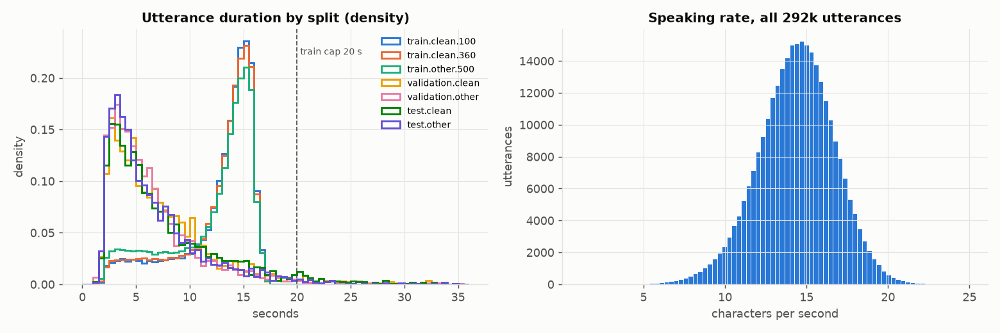
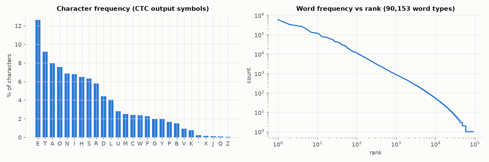
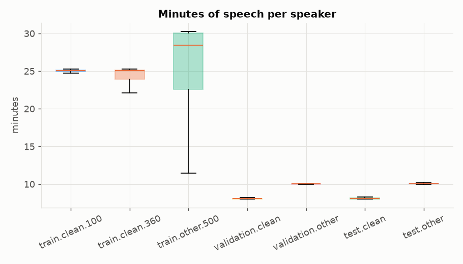
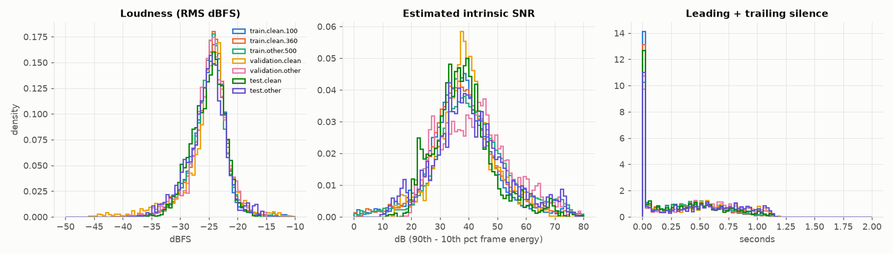
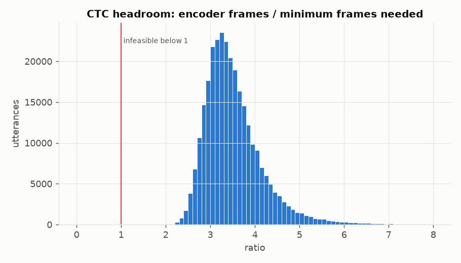
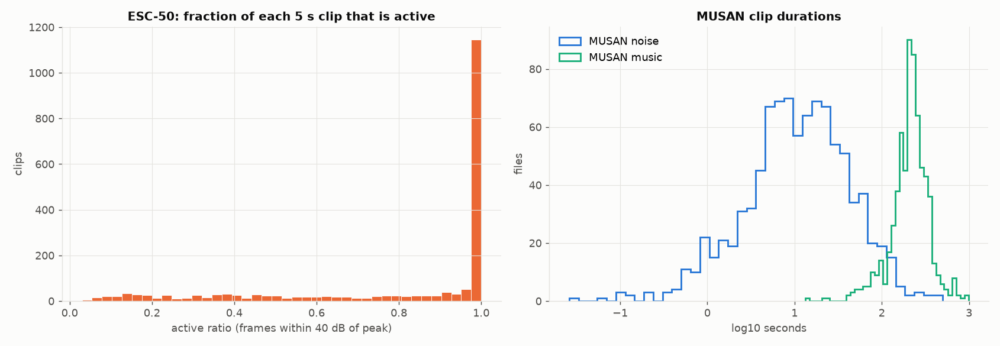
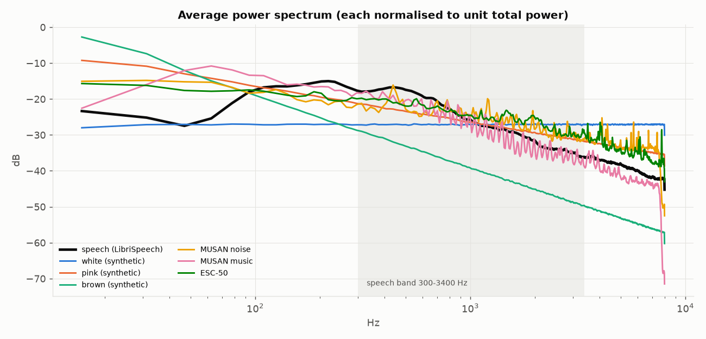
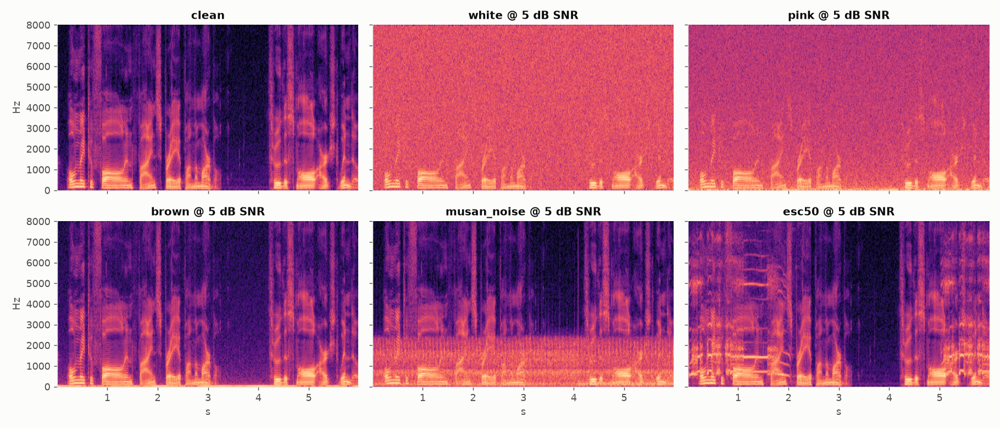

# EDA on the complete data (Milestone 3/4)

Generated by `ai_work/scripts/eda_full.py` from manifests written by `ai_work/scripts/preprocess.py`, which decoded **every** LibriSpeech utterance (all 7 splits) and every MUSAN / ESC-50 file once.

## 1. LibriSpeech overview (all splits)

| ls_split | utterances | hours | speakers | chapters | mean_dur_s | median_dur_s | max_dur_s | mean_words | vocab_words | chars_per_s |
|---|---|---|---|---|---|---|---|---|---|---|
| train.clean.100 | 28,539 | 100.59 | 251 | 585 | 12.69 | 13.99 | 24.52 | 34.69 | 33,798 | 14.54 |
| train.clean.360 | 104,014 | 363.61 | 921 | 2,097 | 12.58 | 13.93 | 29.73 | 34.57 | 59,661 | 14.58 |
| train.other.500 | 148,688 | 496.86 | 1,166 | 2,784 | 12.03 | 13.63 | 27.92 | 32.40 | 66,323 | 14.16 |
| validation.clean | 2,703 | 5.39 | 40 | 97 | 7.18 | 5.92 | 32.65 | 20.13 | 8,333 | 14.49 |
| validation.other | 2,864 | 5.12 | 33 | 91 | 6.44 | 5.25 | 35.16 | 17.79 | 7,350 | 14.27 |
| test.clean | 2,620 | 5.40 | 40 | 87 | 7.42 | 5.79 | 34.95 | 20.07 | 8,138 | 14.26 |
| test.other | 2,939 | 5.34 | 33 | 90 | 6.54 | 5.15 | 34.51 | 17.81 | 7,597 | 13.80 |
| TOTAL | 292,367 | 982.31 | 2,484 | 5,831 | 12.10 | 13.69 | 35.16 | 32.88 | 90,153 | 14.35 |

**Integrity checks (preprocess QC):** decode_failed = 0, empty_text = 0, non_16k = 0, multi_channel = 0, duplicate_ids = 0, ctc_infeasible = 0, text_changed_by_norm = 0.
Speaker overlap train/valid/test: 0 / 0 / 0 (speaker-disjoint official splits).

## 2. Duration and speaking rate

Duration quantiles (all): 1% 2.30s, median 13.69s, 95% 16.07s, 99% 16.73s, max 35.16s. Utterances > 20 s: 294 (0.10%); in train-clean-100 only 1.

## 3. Transcripts

The alphabet is exactly the 32-token wav2vec2 vocabulary: 27 symbols ('ABCDEFGHIJKLMNOPQRSTUVWXYZ). Apostrophes occur 95,939 times (e.g. DON'T, MAN'S) - they are **kept** (the M2/M3 pipeline removed them although the model vocabulary contains them).
Top words: THE (583,636), AND (328,016), OF (289,052), TO (262,023), A (207,478), IN (160,046), I (131,094), HE (126,023), THAT (121,605), WAS (117,886).

Out-of-vocabulary rate of evaluation text w.r.t. training text (relevant because we decode without a language model):

| split | tokens | oov_rate_vs_train100_% | oov_rate_vs_train960_% |
|---|---|---|---|
| validation.clean | 54,402 | 2.46 | 0.62 |
| validation.other | 50,948 | 2.52 | 0.83 |
| test.clean | 52,576 | 2.45 | 0.63 |
| test.other | 52,343 | 2.78 | 0.83 |

## 4. Speakers

Per-split speaker balance is by design (train speakers ~25 min each, dev/test ~8 min each); splits are speaker-disjoint, so evaluation measures generalisation to unseen voices.

## 5. Signal quality

Medians per split:

| ls_split | files_with_clipping | rms_dbfs | peak | clip_frac | lead_sil_s | trail_sil_s | active_ratio | est_snr_db |
|---|---|---|---|---|---|---|---|---|
| train.clean.100 | 131 | -24.73 | 0.53 | 0.00 | 0.05 | 0.05 | 0.84 | 37.31 |
| train.clean.360 | 562 | -24.58 | 0.54 | 0.00 | 0.07 | 0.07 | 0.83 | 37.73 |
| train.other.500 | 807 | -24.72 | 0.53 | 0.00 | 0.17 | 0.13 | 0.80 | 40.57 |
| validation.clean | 2 | -24.53 | 0.50 | 0.00 | 0.20 | 0.21 | 0.81 | 38.96 |
| validation.other | 1 | -24.68 | 0.46 | 0.00 | 0.20 | 0.18 | 0.81 | 42.03 |
| test.clean | 11 | -24.85 | 0.51 | 0.00 | 0.08 | 0.12 | 0.84 | 37.45 |
| test.other | 0 | -25.05 | 0.45 | 0.00 | 0.17 | 0.19 | 0.80 | 39.76 |

Loudness varies by ~15 dB across utterances, so the model input is z-normalised per utterance and SNR mixing is defined relative to each utterance's own power. Silence padding is short (LibriSpeech is already segmented), so no trimming is applied. Recordings are intrinsically clean (median frame-energy dynamic range ~37-42 dB in every split): 'other' is harder because of speakers/accents, not background noise - so added noise is the controlled variable in our experiments.

## 6. CTC length feasibility

Minimum headroom 1.97x, median 3.40x - every utterance can be aligned by CTC at the 20 ms frame rate (0 infeasible).

## 7. Noise corpora

### MUSAN

| corpus | category | files | hours | mean_dur_s | orig_sr | median_rms_dbfs | median_active_ratio |
|---|---|---|---|---|---|---|---|
| musan | music | 660 | 42.61 | 232.44 | 16000 | -16.18 | 0.98 |
| musan | noise | 930 | 6.23 | 24.10 | 16000 | -19.80 | 0.97 |
| musan | speech | 426 | 60.45 | 510.83 | 16000 | -21.28 | 0.79 |

Note: Milestone 2 documents MUSAN as ~7 h music / ~7 h speech / ~6 h noise; the measured sizes above are the correct ones. MUSAN *speech* (babble) is out of scope and not used. File-level train/val split of MUSAN:

| category | excluded_silent | train | unused | val |
|---|---|---|---|---|
| music | 0 | 594 | 0 | 66 |
| noise | 1 | 836 | 0 | 93 |
| speech | 0 | 0 | 426 | 0 |

### ESC-50 (held-out test noise)

2,000 clips x 5 s, 50 classes x 40 clips, originally [44100] Hz -> resampled to 16 kHz. 
Most clips are continuous (median active ratio 1.00), but 21% are short events with silence around them; for those, the active part of the noise is louder than the nominal utterance-level SNR (bursty, realistic interference). Least-active classes: can_opening, sneezing, glass_breaking, door_wood_knock, coughing; most stationary: train, vacuum_cleaner, pig, washing_machine, wind.

## 8. Spectral comparison of speech and noise

| signal | role | energy_in_300-3400Hz_% | energy_below_300Hz_% |
|---|---|---|---|
| speech (LibriSpeech) | - | 60.6 | 35.7 |
| white (synthetic) | train | 38.7 | 3.7 |
| pink (synthetic) | train | 35.1 | 52.5 |
| brown (synthetic) | TEST only | 2.3 | 97.5 |
| MUSAN noise | train | 54.9 | 29.2 |
| MUSAN music | train | 39.5 | 58.3 |
| ESC-50 | TEST only | 59.7 | 28.0 |

Brown noise puts almost all of its energy below 300 Hz, under the speech band, which explains why it barely hurt WER in Milestone 3 even at 0 dB. It is kept as a held-out *synthetic* condition, but ESC-50 is the main held-out realistic test noise. White noise is the most damaging per dB because it has the most energy in the consonant-rich high band.

## 9. What the corruptions look like (same utterance, 5 dB SNR)

