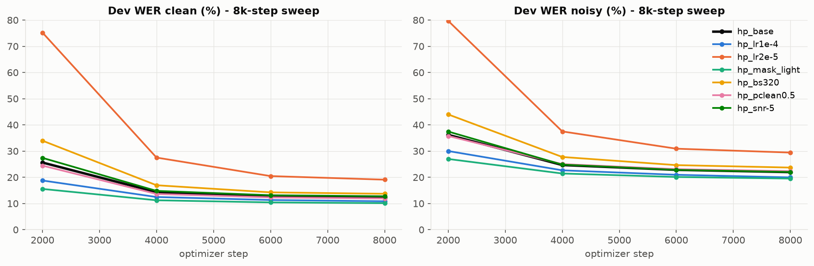
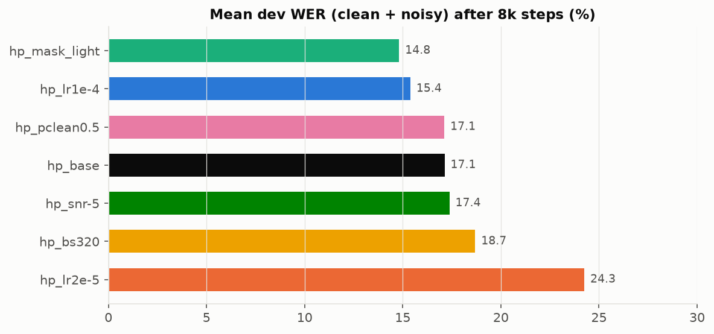
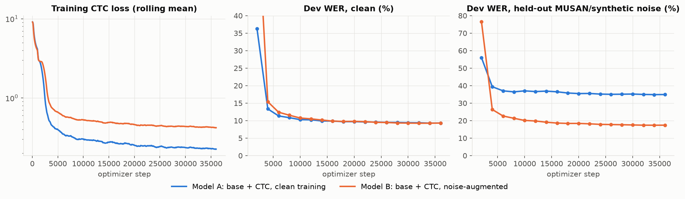
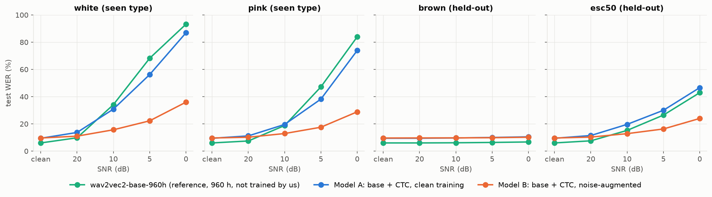

**Noise-Robust Speech Recognition with Word-Level Error Flagging: A Study Using Noise-Augmented Training**

**GROUP 9**

Milestone 4: Model Training and Experimentation

Course: DS-AI Lab · Term: October 2026 · Submission: 19 November 2026

---

## Summary

We fine-tuned the self-supervised **wav2vec 2.0 base** encoder with a character **CTC** head on the full **LibriSpeech train-clean-100** set (28,538 utterances, 100.6 h), twice under an identical recipe:

* **Model A** (clean training).
* **Model B** (on-the-fly noise augmentation with white and pink noise plus MUSAN noise and music, SNR 0–20 dB).

Both were tested on 94,503 fixed test conditions:

* test-clean and test-other;
* clean audio, plus four noise types at four SNRs each.

Two of those noise types, **brown noise and ESC-50 environmental sounds, are never seen** during training or checkpoint selection.

| Headline (test-clean + test-other pooled) | Model A (clean) | Model B (noise-aug.) | Change |
| :---- | ----: | ----: | ----: |
| WER, clean speech | 9.43 % | 9.62 % | +0.19 pts |
| WER, held-out **ESC-50**, 0–5 dB | 38.29 % | **20.12 %** | **−47.5 % relative** |
| WER, held-out brown noise, 0–5 dB | 10.26 % | 10.02 % | −2.3 % relative |
| WER, white noise (seen type), 0–5 dB | 71.53 % | 29.09 % | −59.3 % relative |
| WER, pink noise (seen type), 0–5 dB | 56.05 % | 23.20 % | −58.6 % relative |

Objective O2 is met: at least a 15 % relative WER reduction on held-out noise at 0–5 dB, at a clean-speech cost of at most 2 WER points.

* ESC-50 alone improves by 47.5 %.
* The mean over both held-out types is 24.9 %.
* Clean WER rises by only 0.19 points.

A further 7-run hyperparameter sweep (8,000 steps each) quantifies the sensitivity of the recipe.

**Further improvements (Section 5).** Training on more data (460 h, then all 960 h with reverb, speed and telephone augmentation) and combining models with ROVER lowered WER by a further 21–24 % in every condition. The final system reaches **2.89 % / 6.92 %** on test-clean / test-other and **11.42 %** on held-out ESC-50 at 0–5 dB, with a 4-gram LM (Model B: 3.70 / 8.85 / 15.09 %).

---

## 1. Training Configuration

### 1.1 Datasets

| Dataset | Use in M4 | Size used | Role |
| :---- | :---- | :---- | :---- |
| LibriSpeech **train-clean-100** | training | 28,538 utts, 100.6 h, 251 speakers | speech + transcripts |
| LibriSpeech **dev-clean + dev-other** | validation / checkpoint selection | 5,567 utts, 10.5 h (2,000-utt subset × {clean, noisy} = 4,000 rows used for selection) | speaker-disjoint |
| LibriSpeech **test-clean + test-other** | final test | 5,559 utts, 10.7 h × 17 conditions = 94,503 rows (182.7 h) | speaker-disjoint |
| **MUSAN** noise (930 files) + music (660 files) | training noise (836 noise + 594 music files) / validation noise (93 + 66 other files); 1 silent file excluded | 6.2 h noise, 42.6 h music | seen noise types |
| Synthetic **white / pink** | training + test ("seen-type" reference) | generated on the fly | seen noise types |
| Synthetic **brown** | **test only** | generated per condition | held-out type |
| **ESC-50** (2,000 clips, 50 classes) | **test only** (1,999 clips; 1 digitally silent clip excluded) | 2.8 h | held-out type |

The other 860 h of LibriSpeech (train-clean-360, train-other-500) were preprocessed and profiled in the EDA. They were not used for Models A and B, but were used in the follow-up runs B460 (train-clean-100 + 360, 464 h) and B960_rev (all 960.7 h), described in Section 5.
MUSAN speech is excluded: babble noise is out of the project's scope.

### 1.2 Preprocessing

The preprocessing is implemented in `scripts/preprocess.py`, which runs in parallel over 120 CPU processes. Its outputs go to `data/processed/`.

1. **Decoding:** audio is read directly from the downloaded Hugging Face arrow shards, which store the original FLAC bytes. This avoids duplicating 982 h of audio as WAV files.
2. **Quality control on all 292,367 utterances:**
   * 0 decode failures, 0 empty transcripts, 0 duplicate IDs;
   * all files are 16 kHz mono;
   * 0 CTC-infeasible utterances, meaning every transcript fits into the number of frames the model produces (Section 1.3);
   * per-file loudness, clipping, silence and estimated SNR are stored for the EDA.
3. **Text normalisation:** a single function, `data/text.py::normalize_text`, is used for training labels *and* evaluation references:
   * upper-case;
   * keep A–Z, the apostrophe and space;
   * collapse whitespace.
   
   This fixes the M3 inconsistency, where apostrophes were dropped from the data but kept in the vocabulary.
4. **Filtering:** training utterances must be 1–20 s long. Only one utterance (> 20 s) was removed.
5. **Splits:** the official, speaker-disjoint LibriSpeech splits are used. An assertion checks that no utterance ID is shared, and 0 speakers are shared between any two splits.
6. **Noise banks:**
   * MUSAN and ESC-50 are resampled to 16 kHz mono and stored as memory-mapped float16 arrays.
   * MUSAN gets a seeded **file-level 90/10 train/validation split**, so validation noise *recordings* are never trained on.
   * Digitally silent clips are excluded, because an SNR cannot be set on silence.
7. **Noise mixing (`data/noise.py::mix_at_snr`):** the noise is scaled so that the SNR computed over the whole utterance exactly matches the target. No clipping is applied.
   * **Training:** on the fly (a new random noise every epoch). With 20 % probability the audio stays clean; otherwise a random type from {white, pink, MUSAN noise, MUSAN music} is used at SNR ~ U[0, 20] dB.
   * **Validation and test:** fixed and seeded per utterance (CRC32 of id, noise type, SNR), so all models see *identical* noisy audio.
8. **Model input:** each waveform is z-score normalised (zero mean, unit variance), as wav2vec 2.0 expects. Labels are encoded with the 32-symbol vocabulary of `facebook/wav2vec2-base-960h`.

### 1.3 Model architecture (recap of M3)

| Component | Details | Parameters | Trained? |
| :---- | :---- | ----: | :---- |
| CNN feature encoder | 7 temporal conv layers (512 ch, kernels 10,3,3,3,3,2,2 / strides 5,2,2,2,2,2,2) → one 512-d frame per **20 ms** | 4,200,448 | frozen |
| Feature projection | LayerNorm + linear 512 → 768, dropout | (in Transformer count) | yes |
| Positional conv embedding | grouped conv (kernel 128, 16 groups) | | yes |
| Transformer encoder | 12 layers, 768 hidden, 12 heads, FFN 3,072, LayerDrop | 90,171,264 | yes |
| CTC head (new) | dropout + linear 768 → 32 tokens (blank, `\|` word delimiter, A–Z, `'`, special tokens) | 24,608 | yes |
| **Total** | | **94,396,320** | 90,195,872 trainable |

* **Initialisation:** `facebook/wav2vec2-base`, which is self-supervised on 960 h of LibriSpeech audio and has **never seen transcripts**. We train the CTC head from scratch.
* **Decoding:** greedy CTC: take the most likely token per frame, merge repeats, drop blanks, and split words at `|`.
* **Word confidence and timestamps (for O3/O4):** for every output word we record:
  * `conf_min`, the minimum per-frame max-posterior over the frames that emit the word;
  * `conf_mean`, the mean of the same values;
  * the start and end times (frame index × 20 ms).

### 1.4 Training setup

The configuration is in `configs/train_A_clean.yaml` and `configs/train_B_noisy.yaml`. The two files are identical except for the noise-augmentation keys. The training loop is `scripts/train.py`.

| Item | Setting |
| :---- | :---- |
| Loss | CTC (blank = 0), computed with the **true unpadded** frame counts per utterance, mean over the batch of loss / target length, `zero_infinity` |
| Evaluation metrics | WER and CER (jiwer). Checkpoint selection uses **mean dev WER of clean + noisy**. Word-error AUROC of confidence is reported for O3. |
| Optimizer | AdamW, β = (0.9, 0.98), ε = 1e-8, weight decay 0.005 (none on biases / norms), fused CUDA kernel |
| Learning rate | peak **5e-5**, linear warm-up over 8 % of steps (2,880), then linear decay to 0 |
| Batch size | dynamic: **≤ 640 s of padded audio per step** (≤ 64 utterances); length-bucketed batches give ≈ 605 batches/epoch, ≈ 47 utterances per batch |
| Steps / epochs | **36,000 optimizer steps ≈ 59.5 epochs** of the 100 h set |
| Regularisation | time masking p = 0.4 (span 10 frames), feature masking p = 0.1 (span 64), LayerDrop 0.1, attention/hidden dropout 0.1, frozen CNN encoder |
| Gradient handling | clip global norm at 1.0; skip the update if the norm is non-finite |
| Precision | bfloat16 autocast; loss and log-softmax in float32; TF32 matmuls |
| Validation | every 2,000 steps on the 4,000-row dev set (≈ 10 s per evaluation); `best/` saved on improvement, `last/` + optimizer state every 2,000 steps |
| Seed | 42 (data order, noise and initialisation of the new head) |
| Hardware | 1 × NVIDIA **L40S** (46 GB; peak use 10.9 GB), 128 CPU cores (28 data-loader workers decode FLAC and mix noise), 498 GB RAM |
| Speed / time | 0.377 s per step, ≈ 1,580 s of audio per second; **3 h 53 min per 36k-step run** |
| Software | PyTorch 2.14 (CUDA 13.0), transformers 5.23, jiwer 4.0; exact versions in `requirements.txt` |

The follow-up runs of Section 5 use the same recipe with these differences: B2 lr 1e-4; B460 464 h, lr 1e-4, 80k steps (≈ 28 epochs, ≈ 8 h); B960_rev 960 h, starts from B460, lr 5e-5, 5 % warm-up, 40k steps (≈ 6.8 epochs, ≈ 4 h, peak memory 14.8 GB).

The recipe follows the published wav2vec 2.0 base 100 h fine-tuning setup, with slightly milder masking and LayerDrop. We picked it before the sweep: a 60-step smoke test checked memory and throughput first. Section 2 then tests how sensitive the result is to each choice.

---

## 2. Hyperparameter Experiments

**Design:**
* 7 runs, all with the **Model B (noise-augmented) recipe**.
* Each run trains for **8,000 steps** (≈ 13 epochs, ≈ 52 min) with the same seed and the same dev set.
* Each run changes **one** setting relative to `hp_base`.

A full 36k-step run takes about 4 h, so 8k-step runs let us compare seven settings in one night (6 h of GPU time in total). Results are the dev WER at step 8,000. The test set was **not** used for any of these decisions.

| Run | Change vs. `hp_base` | Epochs | Dev WER clean | Dev WER noisy | **Mean** | Δ mean vs. base |
| :---- | :---- | ----: | ----: | ----: | ----: | ----: |
| `hp_base` | – (lr 5e-5, 640 s batches, strong masking, p_clean 0.2, SNR 0–20 dB) | 13.3 | 12.29 % | 21.98 % | 17.13 % | – |
| `hp_lr1e-4` | learning rate 5e-5 → **1e-4** | 13.3 | 10.83 % | 19.95 % | 15.39 % | **−1.74** |
| `hp_lr2e-5` | learning rate 5e-5 → **2e-5** | 13.3 | 19.09 % | 29.43 % | 24.26 % | +7.12 |
| `hp_mask_light` | time mask 0.4 → 0.05, feature mask 0.1 → 0, LayerDrop 0.1 → 0.05 | 13.3 | 10.13 % | 19.51 % | **14.82 %** | **−2.31** |
| `hp_bs320` | batch 640 → **320** padded seconds | 7.0 | 13.69 % | 23.70 % | 18.70 % | +1.56 |
| `hp_pclean0.5` | clean fraction 0.2 → **0.5** | 13.3 | 11.90 % | 22.35 % | 17.12 % | −0.01 |
| `hp_snr-5` | SNR range 0–20 → **−5–20 dB** | 13.3 | 12.75 % | 22.01 % | 17.38 % | +0.25 |





**Interpretation:**

* **Learning rate is the most important knob.**
  * 2e-5 is clearly too low: at step 2,000 the model is still mostly emitting blanks (75 % clean WER) and it never catches up.
  * 1e-4 learns faster and is 1.7 points better at 8k steps.
  * Because our full runs use a 4.5× longer schedule, the 5e-5 peak has much more time to converge: the full B run reaches 13.3 % mean dev WER against 17.1 % for `hp_base` at 8k. The gap at 8k therefore mainly measures *speed*, not the final quality.
* **Light masking is best within 8k steps, but it is overfitting.** Its training loss (0.16) is **3.6× lower** than `hp_base` (0.57), while dev WER is only 2.3 points better. Masking is a regulariser whose benefit usually appears late in training. Over 36k steps on 100 h, the light setting is expected to overfit more, so we kept strong masking for the main runs. Verifying this at 36k is listed in Section 7.
* **Batch 320 s:** at an equal number of *steps* it sees half the audio (7 epochs). It is worse, and noisier: its largest gradient norm is 19.9 vs 9.6 for the base. 640 s batches fit easily in memory (10.9 GB), so we kept them.
* **Clean fraction 0.5:** no measurable change in the mean (−0.01), with a slight clean gain (−0.4 points) and a noisy loss (+0.4 points). We kept 0.2, which favours robustness.
* **Harder SNR range (−5 dB):** no gain on our dev noise (min 0 dB), so we kept 0–20 dB.

**Decision.** The main runs (lr 5e-5, strong masking, 640 s, p_clean 0.2, SNR 0–20) are not the fastest at 8k, but they are the most regularised configuration that converges within the 36k budget. A 36k-step B run with **lr 1e-4** was the first follow-up.

**Follow-up at full length (B2, 36k steps, lr 1e-4):** best mean dev WER **13.06 %** vs 13.32 % for B, and test results within ±0.3 points of B (Section 5.3). The 8k-step advantage of lr 1e-4 therefore shrinks to a small gain once both runs converge, which confirms that the sweep at 8k mainly measured speed. lr 1e-4 was kept for the 464 h run B460.

---

## 3. Generalisation and Training Stability

### 3.1 Generalisation techniques and their impact

| Technique | Purpose | Observed impact |
| :---- | :---- | :---- |
| **On-the-fly noise augmentation** (Model B) | robustness to unseen noise | The main result. The only difference between A and B: held-out ESC-50 at 0–5 dB **38.3 % → 20.1 % WER**; dev noisy 34.9 % → 17.4 %. Clean cost: +0.19 points (test), −0.03 points (dev). |
| **Held-out noise sources** (MUSAN 90/10 file split; brown + ESC-50 test-only) | an honest test of generalisation instead of memorised noise | Checkpoint selection never saw test noise. Gains on ESC-50 are real transfer, not memorisation. |
| **Self-supervised pretraining** (wav2vec2-base) | strong speech representations from unlabelled audio | 100 h of labelled data reaches 9.4 % pooled clean test WER. |
| **Frozen CNN feature encoder** | keeps the low-level acoustic filters learned from 960 h | Fewer trainable parameters (90.2 M), and no early drift of the acoustic front end |
| **Time and feature masking** (SpecAugment-style, p = 0.4 / 0.1) | forces the use of context and prevents memorisation | Sweep: removing most of it lowers training loss 3.6× but improves dev WER only 2.3 points at 8k, so it acts as a real regulariser (Section 2) |
| **LayerDrop 0.1, dropout 0.1, weight decay 0.005** | regularise the Transformer | Train/dev gap remains moderate: B's final train loss is 0.42, and its dev WER is still slowly falling at 36k (Fig. 1) |
| **Model selection on mean (clean + noisy) dev WER** | avoids choosing a checkpoint that is good only on clean audio | Best checkpoint at step 34k for both models; improvements after 30k are < 0.1 points |
| **Speaker-disjoint splits** | no speaker leakage | 0 shared speakers between train, dev and test |
| **More labelled data** (464 h, then 960 h; Section 5) | more speakers, accents and words | B460: −14 to −20 % WER in every condition vs B |
| **Reverb, speed 0.9/1.1 and telephone-band augmentation** (B960_rev) | robustness to rooms, speaking rate and channel | Real-room reverb (test-only rooms): 20.2 % → 12.6 % WER; test-other 7.58 % → 7.01 % (with LM) |
| **Continued fine-tuning** from B460 (lr 5e-5, 5 % warm-up) | add new data and distortions without starting over | Dev WER 10.71 % → 9.87 % in 40k steps; no forgetting on clean dev (4.96 % → 4.47 % with LM) |



*Figure 1:*
* **Left:** B's training loss stays higher than A's because its inputs are harder (noisy). This is expected and not a sign of underfitting.
* **Middle:** the clean dev WER curves are almost identical after 15k steps, so noise training costs nothing on clean dev speech.
* **Right:** A's noisy WER plateaus at ≈ 35 % after only 6k steps; extra clean training does not buy robustness. B keeps improving down to 17.4 %.

### 3.2 Training-stability techniques and their impact

| Technique | Why | Observed impact |
| :---- | :---- | :---- |
| **Linear warm-up (8 %) + linear decay** | protects the pretrained weights from large early updates | No loss spikes. The usual CTC "blank plateau" (loss ≈ 3, model emits only blanks) ended around step 1,800–2,500. |
| **Gradient clipping at 1.0 + skipping non-finite steps** | guards against exploding CTC gradients on hard utterances | Raw gradient norms peaked at 14.6 (B) and 13.7 (A) and were clipped. **0 non-finite steps** in all 13 runs, including the follow-up runs of Section 5 (largest raw norm 97.7 in B960_rev, a single spike that clipping absorbed). |
| **bfloat16 autocast with float32 loss** | speed and memory savings without fp16 overflow / loss-scaling issues | 10.9 GB peak memory at 640 s batches; no NaN or inf losses |
| **CTC on true frame lengths + `zero_infinity`** | padding frames are not scored as silence; impossible alignments cannot produce infinite loss | QC confirmed 0 CTC-infeasible utterances; no infinite losses occurred |
| **Duration-bucketed dynamic batches (≤ 640 s)** | constant GPU memory, minimal padding | Peak memory constant at 10.9 GB; no OOM during training |
| **AdamW β₂ = 0.98** | faster adaptation of second-moment estimates (standard for wav2vec 2.0) | Smooth curves |
| **Resumable checkpoints** (`last/` + optimizer, scheduler, step) + **tmux under a systemd scope** | the SSH session to the server dropped repeatedly | Early run killed at step ~100 when the session ended. After the fix, all 13 runs completed without interruption. |
| **Fixed seeds** (data order, noise, dev/test corruption) | reproducibility, fair A/B comparison | A and B are evaluated on bit-identical noisy audio |

---

## 4. Results and Observations

### 4.1 Quantitative results (test set, 94,503 utterance-conditions)

The reference row is `facebook/wav2vec2-base-960h`, the same base model fine-tuned by its authors on **960 h** of labelled data. It is shown only as an upper bound for clean speech; we did not train it. Its clean scores (3.43 % / 8.59 %) reproduce the published numbers, which validates our evaluation pipeline.

**WER (%), test-clean + test-other pooled:**

| Noise | SNR | Reference (960 h) | Model A (clean) | **Model B (noise-aug.)** |
| :---- | ----: | ----: | ----: | ----: |
| clean | – | 6.00 | 9.43 | 9.62 |
| white (seen type) | 20 / 10 / 5 / 0 | 9.8 / 34.1 / 68.2 / 93.2 | 13.7 / 30.8 / 56.2 / 86.9 | **11.0 / 15.7 / 22.3 / 35.9** |
| pink (seen type) | 20 / 10 / 5 / 0 | 7.4 / 18.8 / 47.2 / 83.9 | 11.2 / 19.6 / 38.2 / 73.9 | **10.2 / 12.9 / 17.6 / 28.9** |
| **brown (held-out)** | 20 / 10 / 5 / 0 | 6.0 / 6.1 / 6.4 / 6.7 | 9.5 / 9.7 / 10.0 / 10.5 | 9.7 / 9.7 / 9.9 / 10.2 |
| **ESC-50 (held-out)** | 20 / 10 / 5 / 0 | 7.6 / 15.2 / 26.4 / 42.9 | 11.4 / 19.6 / 30.0 / 46.6 | **10.3 / 12.8 / 16.3 / 24.0** |

| Per split, clean | Reference | Model A | Model B |
| :---- | ----: | ----: | ----: |
| test-clean | 3.43 | 5.85 | 6.19 |
| test-other | 8.59 | 13.03 | 13.08 |

**Comparison with the published wav2vec 2.0 results.** Baevski et al. (2020, *wav2vec 2.0*, NeurIPS) report the BASE model fine-tuned on 100 h of labelled data (train-clean-100). This is exactly our set-up for Model A, so it is the fair baseline.

| Test WER (%) | Decoding | test-clean | test-other |
| :---- | :---- | ----: | ----: |
| wav2vec 2.0 paper, BASE, 100 h labelled | no LM | 6.1 | 13.3 |
| **Our Model A (clean), 100 h** | no LM (greedy) | **5.85** | **13.03** |
| Our Model B (noise-aug.), 100 h | no LM (greedy) | 6.19 | 13.08 |
| wav2vec 2.0 paper, BASE, 100 h labelled | 4-gram LM (wide beam, tuned weights) | 3.4 | 8.0 |
| Our Model A + 4-gram LM | beam 50 | 3.69 | 9.04 |
| Our Model B + 4-gram LM | beam 50 | 3.70 | 8.85 |
| wav2vec 2.0 paper, BASE, 960 h labelled | no LM / 4-gram LM | 3.4 / 2.6 | 8.5 / 6.1 |
| *M5 progress:* our B460 (460 h, noise-aug.) | no LM / 4-gram LM | 4.70 / 2.97 | 11.09 / 7.58 |

* **Without a language model our baseline reproduces the paper.** Model A is 0.25–0.27 points *better* than the published 100 h result. This confirms that the training recipe and the pipeline are correct. Model B stays within 0.2 points of the paper's 100 h result, even though it was trained mostly on noisy audio.
* **With the 4-gram LM we are 0.3–1.0 points behind the paper.** The acoustic models are on par (see the no-LM rows), so the gap comes from the decoder: the paper uses a much wider beam and LM weights tuned by Bayesian optimisation, while we use a beam of 50 and a small α/β grid.
* **The paper reports clean speech only.** Every noisy-condition result in this report is outside the published benchmark.
* **M5 progress:** B460 lies between the paper's 100 h and 960 h results, as its 460 h of labelled data would predict. With the LM it already beats the paper's 100 h result (2.97 / 7.58 vs 3.4 / 8.0).



Observations:

1. **Noise training transfers to unseen real-world noise.** On ESC-50 at 0 dB, B (24.0 %) roughly halves A's WER (46.6 %). B also beats the reference model, which was trained on **9.6× more labelled data** (42.9 %), from 10 dB downwards.
2. **More clean data does not buy robustness.** On white noise at 0 dB the 960 h reference is *worse* than our 100 h model A (93.2 % vs 86.9 %), and B is at 35.9 %.
3. **Brown noise is not a useful test condition.** ≈ 97 % of its energy lies below 300 Hz (EDA), mostly below the speech band. Even at 0 dB it adds less than 1 point of WER for every model. It cannot show a difference between A and B.
4. **Cost on clean speech is small but measurable:** +0.34 points on test-clean, +0.05 on test-other.
5. **Inference speed:** 182.7 h of test audio decoded in ≈ 220 s on one L40S (≈ 2,990× real time).

### 4.2 Word-confidence error detection (preview of O3)

Word-level AUROC: how well 1 − confidence ranks wrong words above correct ones, over all 17 test conditions.

| Model | AUROC (`conf_mean`) | AUROC (`conf_min`) |
| :---- | ----: | ----: |
| Reference (960 h) | 0.934 | 0.904 |
| Model A | 0.908 | 0.862 |
| Model B | 0.879 | 0.836 |

Raw CTC confidence already detects errors well (AUROC 0.88–0.93), and `conf_mean` is better than `conf_min` for every model.

B's AUROC is *lower* than A's. One likely contributor: B makes far fewer, harder errors in noise, so the easy errors are gone. We have not yet verified this. A trained error detector that fixes this (gradient-boosted trees on 14 word features: AUROC 0.89, ECE 0.006, objective O3 met in all 17 conditions) is reported in Section 5.3.

### 4.3 Sample outputs (qualitative)

The examples below were **selected** from test utterances of 8–18 words: the first case where B is at least 20 points better than A in each condition. They illustrate typical improvements, not average behaviour. Two counter-examples follow them.

| Condition | Reference | Model A (clean) | Model B (noise-aug.) |
| :---- | :---- | :---- | :---- |
| clean | STUFF IT INTO YOU HIS BELLY COUNSELLED HIM | … BELLY **COUNSELED** HIM | … BELLY **COUNSELED** HIM |
| ESC-50, 5 dB | STUFF IT INTO YOU HIS BELLY COUNSELLED HIM | **SIDOFFERED** INTO YOU HIS BELLY COUNSELED HIM | STUFF IT INTO YOU HIS BELLY COUNSELED HIM |
| ESC-50, 0 dB | AFTER EARLY NIGHTFALL THE YELLOW LAMPS WOULD LIGHT UP HERE AND THERE THE SQUALID QUARTER OF THE BROTHELS | **N ATA AIRLY** NIGHTFALL THE YELLOW **LDEN E** LIGHT UP HERE AND THERE **WALLID CRER ISLES** | AFTER EARLY NIGHTFALL THE YELLOW LAMPS WOULD LIGHT UP HERE AND THERE **INTE** SQUALID **QARTER E RIVALS** |
| white, 5 dB | A COLD LUCID INDIFFERENCE REIGNED IN HIS SOUL | A COLD **ELUTE IT INDIFFERENTE** REIGNED IN HIS SOUL | A COLD LUCID INDIFFERENCE **EREIGNED** IN HIS SOUL |
| white, 0 dB | STUFF IT INTO YOU HIS BELLY COUNSELLED HIM | **TUFF** IT INTO YOU **YOU FELLY COUNT WITH** HIM | STUFF IT INTO YOU **ADAND** HIS **FELLY COUNCELT** HIM |

**Counter-examples (clean speech, where B is worse than A):**

| Reference | Model A | Model B |
| :---- | :---- | :---- |
| … AS WE GO WITH KEENER EYES | … WITH KEENER EYES | … WITH **KEENEREYES** |
| PERSONALLY AS YOU CALL IT AND ALL | (correct) | … IT **ANDOALL** |

**Typical error types:**
* spelling-level mistakes on rare words (COUNSELED, QARTER), since there is no language model;
* merged or split words when the word-boundary token `|` is missed;
* in very low SNR, phonetically plausible non-words.

An external language model fixes many of these. The same utterances decoded by Model B with the 4-gram LM and by the final system of Section 5 (ROVER of B960_rev_s2, B960_rev and B460, with the LM):

| Condition | Reference | B + LM | **Final system** |
| :---- | :---- | :---- | :---- |
| clean | … BELLY COUNSELLED HIM | … **COUNSELED** HIM | … COUNSELLED HIM ✓ |
| white, 5 dB | A COLD LUCID INDIFFERENCE REIGNED IN HIS SOUL | ✓ | ✓ |
| white, 0 dB | STUFF IT INTO YOU HIS BELLY COUNSELLED HIM | … YOU **AND** HIS BELLY **COUNSELED** HIM | … YOU **AND** HIS BELLY COUNSELLED HIM |
| ESC-50, 5 dB | CONCORD RETURNED TO ITS PLACE AMIDST THE TENTS | ✓ (greedy B: CONICHORD) | ✓ |
| ESC-50, 0 dB | … HERE AND THERE THE SQUALID QUARTER OF THE BROTHELS | … THERE **IN THE** SQUALID QUARTER **RIVALS** | … THERE **IN THE** SQUALID QUARTER OF THE **BRATTLES** |
| clean (counter-examples above) | … KEENER EYES / … IT AND ALL | ✓ / ✓ | ✓ / ✓ |
| ESC-50, 5 dB (**new failure**) | STUFF IT INTO YOU HIS BELLY COUNSELLED HIM | ✓ (except COUNSELED) | **STUFFED** INTO YOU … COUNSELLED HIM |

The LM repairs spelling-level and word-boundary errors (KEENEREYES, ANDOALL, CONICHORD). What remains are rare words under heavy noise (BROTHELS → BRATTLES) and plausible-sounding merges (STUFF IT → STUFFED), where the LM prefers a common word.

**Word confidence and timestamps (Model B, ESC-50 at 5 dB):**

* Reference: *CONCORD RETURNED TO ITS PLACE AMIDST THE TENTS*
  * Output words with `conf_min` (✗ = wrong word): **CONICHORD** 0.39 ✗ · RETURNED 0.56 · TO 1.00 · ITS 0.74 · PLACE 0.98 · AMIDST 0.58 · **THE 0.44** · TENTS 0.99.
  * Timestamps: CONICHORD spans 0.58–1.12 s.
* Reference: *BUT IN THIS FRIENDLY PRESSURE RAOUL COULD DETECT …*
  * Output words: … PRESSURE 0.58 · **ROWL** 0.46 ✗ · **COULD 0.45** · DETECT 0.99 · **THE 0.41** …

With a threshold of 0.5, both real errors (the rare names CONCORD → CONICHORD and RAOUL → ROWL) are flagged. Short function words (THE, COULD) are also flagged although they are correct. Reducing these false alarms is the goal of the M5 calibration work.

---

## 5. Further Improvements (18–19 November): Lowering the Error Rate

After the main runs we spent the last two days on one goal: lower WER everywhere without giving up robustness. Each step below was decided on the **dev set only**; the test set was decoded once per final model.

### 5.1 What we trained

| Run | Starts from | Training data | Augmentation | Steps (≈ epochs) | lr | Best dev WER (avg) |
| :---- | :---- | :---- | :---- | ----: | ----: | ----: |
| B (M4) | wav2vec2-base | train-clean-100 (100 h) | noise, SNR 0–20 dB | 36k (≈ 59.5) | 5e-5 | 13.32 % |
| B2 | wav2vec2-base | train-clean-100 | as B | 36k (≈ 59.5) | **1e-4** (from the sweep) | 13.06 % |
| **B460** | wav2vec2-base | train-clean-100 + 360 (464 h) | as B | 80k (≈ 28.4) | 1e-4 | 10.71 % |
| **B960_rev** | **B460 best** | all 960 h (incl. train-other-500) | as B **+ simulated-room reverb (p 0.3), speed 0.9/1.1 (p 0.3), telephone band-limit (p 0.1)** | 40k (≈ 6.8) | 5e-5 | **9.87 %** |
| B960_rev_s2 | B460 best | as B960_rev | as B960_rev, seed 7 | 40k (≈ 6.8) | 5e-5 | 9.95 % |

* **More labelled data** (B460) gave the largest single gain. It is a fresh fine-tune of wav2vec2-base; B2's higher learning rate was carried over.
* **B960_rev continues training from B460** instead of starting over: in about 4 GPU-hours it adds the harder `train-other-500` speakers and three new distortions (reverberation, speed, telephone band). Training reverb uses *simulated* rooms; the reverb test uses *real measured* rooms only, so it remains a held-out condition.
* Every run used the same batch size (≤ 640 s of audio per step), masking, LayerDrop and fixed-step schedule as Model B; `best/` is the checkpoint with the lowest mean dev WER.

### 5.2 Combining models: ROVER

Two separately trained CTC models cannot be averaged frame by frame: their character spikes fall on different frames (only about 80 % agreement on non-blank frames). Averaging made dev WER *worse* (9.12 → 9.74 % clean for B2 + B). We therefore combine systems **after** decoding, at the word level (ROVER, Fiscus 1997, `scripts/rover.py`):

* the hypotheses of the other systems are aligned to a pivot system;
* each word position is decided by a vote weighted by word confidence (λ = 0.5).

On dev, ROVER only helped when the systems were of similar quality: B960_rev + B460 + B2 was worse than B960_rev alone (4.65 vs 4.47 % clean), because the weaker models outvoted correct words. With the second seed, **B960_rev_s2 (pivot) + B960_rev + B460, λ = 0.5** was best (dev 4.42 / 9.21 % clean / noisy vs 4.48 / 9.34 % for the best single model). This configuration was then run on test once.

### 5.3 Final test results

**WER (%), 4-gram LM beam search (α 0.8, β 2.0, beam 50); "pooled" = test-clean + test-other:**

| Condition | Model A | Model B (M4) | B460 | B960_rev | **Final (ROVER)** | Final vs B |
| :---- | ----: | ----: | ----: | ----: | ----: | ----: |
| test-clean | 3.69 | 3.70 | 2.97 | 2.97 | **2.89** | −22 % |
| test-other | 9.04 | 8.85 | 7.58 | 7.01 | **6.92** | −22 % |
| clean, pooled | – | 6.27 | 5.27 | 4.99 | **4.90** | −22 % |
| ESC-50 0–5 dB (held-out) | – | 15.09 | 12.66 | 11.75 | **11.42** | −24 % |
| brown 0–5 dB (held-out) | – | 6.55 | 5.56 | 5.11 | **5.03** | −23 % |
| white 0–5 dB | – | 22.79 | 19.60 | 18.47 | **17.97** | −21 % |
| pink 0–5 dB | – | 17.63 | 15.01 | 13.92 | **13.63** | −23 % |
| all noisy conditions, pooled | – | 11.62 | 9.85 | 9.16 | **8.94** | −23 % |

**Harder held-out conditions (greedy decoding, pooled):**

| Condition | Model B | B460 | B960_rev |
| :---- | ----: | ----: | ----: |
| real-room reverb, no noise | 20.18 | 17.89 | **12.56** |
| real-room reverb + ESC-50 at 5 dB | 36.36 | 32.61 | **25.62** |
| real-room reverb + ESC-50 at 0 dB | 47.51 | 43.01 | **35.70** |
| ESC-50 at −5 dB | 38.21 | 32.91 | **31.01** |
| white at −5 dB | 60.73 | 55.24 | **53.30** |

**Greedy decoding (no LM), test-clean / test-other:** B 6.19 / 13.08 → B460 4.70 / 11.09 → B960_rev **4.63 / 9.95**.

**Word-level error detection (O3), GBM detector, all 17 test conditions with the LM:**

| Model | AUROC (≥ 0.75) | Errors in riskiest 30 % (≥ 70 %) | ECE (≤ 0.10) |
| :---- | ----: | ----: | ----: |
| Model B | 0.891 | 85.6 % | 0.005 |
| B460 | 0.894 | 86.6 % | 0.007 |
| B960_rev | 0.892 | 86.5 % | 0.006 |

### 5.4 Observations

1. **The error rate fell by 21–24 % relative in every condition** compared with Model B, including both held-out noise types. The final system reaches 2.89 % on test-clean, below the published wav2vec 2.0 BASE 100 h result with an LM (3.4 %) and close to the BASE 960 h result (2.6 %), which was measured on clean speech only.
2. **Data quantity mattered most.** B460 alone cut WER by 14–20 % relative to B in every condition. B960_rev added another 6–8 % on test-other and in every noise condition (test-clean unchanged); its extra data and distortions helped most where they target a weakness: real-room reverberation fell from 20.2 % to 12.6 % (−38 %), and test-other from 7.58 % to 7.01 %.
3. **Continued fine-tuning is efficient:** B960_rev beats B460 after only 40k steps (≈ 4 GPU-hours) because it starts from B460's weights instead of from wav2vec2-base.
4. **ROVER gives a small but consistent extra gain** (−0.1 to −0.5 points in every condition). The two seeds make very similar errors, which limits it; it needs systems of similar quality.
5. **Error detection is unaffected by the stronger models** (AUROC ≈ 0.89, ECE < 0.01); O3 remains met.
6. **Cost:** the final system runs three acoustic models plus the LM. For the real-time demo (O5) a single B960_rev with the LM is the practical choice: it is within 0.1–0.5 points of ROVER.

Result files: `experiments/results/{B460,B960_rev,B960_rev_s2}{,_ext,_lm4}/`, `experiments/results/rover3_final/`; configs in `configs/train_{B460,B960_rev,B960_rev_s2}.yaml`.

---

## 6. Training Artifacts

All artifacts are in the repository under clearly named folders. Model weights are **not** committed (378 MB per checkpoint; ≈ 1.4 GB per run with optimizer state). They are kept on the group's GPU server under the same paths, and all six fully trained models are **published on Hugging Face** (public, Apache-2.0, each with a model card, usage example and test results; load with `Wav2Vec2ForCTC.from_pretrained(...)`):

| Model | Hugging Face repository |
| :---- | :---- |
| **B960_rev** (best single model) | [https://huggingface.co/kumargulshan/wav2vec2-base-ls960-noise-robust](https://huggingface.co/kumargulshan/wav2vec2-base-ls960-noise-robust) |
| B960_rev_s2 (seed 7, ROVER member) | [https://huggingface.co/kumargulshan/wav2vec2-base-ls960-noise-robust-seed7](https://huggingface.co/kumargulshan/wav2vec2-base-ls960-noise-robust-seed7) |
| B460 | [https://huggingface.co/kumargulshan/wav2vec2-base-ls460-noise-aug](https://huggingface.co/kumargulshan/wav2vec2-base-ls460-noise-aug) |
| **Model B** (B_noisy) | [https://huggingface.co/kumargulshan/wav2vec2-base-ls100-noise-aug](https://huggingface.co/kumargulshan/wav2vec2-base-ls100-noise-aug) |
| B2 (lr 1e-4) | [https://huggingface.co/kumargulshan/wav2vec2-base-ls100-noise-aug-lr1e-4](https://huggingface.co/kumargulshan/wav2vec2-base-ls100-noise-aug-lr1e-4) |
| **Model A** (A_clean) | [https://huggingface.co/kumargulshan/wav2vec2-base-ls100-clean](https://huggingface.co/kumargulshan/wav2vec2-base-ls100-clean) |

The published weights were checked to be byte-identical (SHA-256) to the local `best/` checkpoints and reproduce the pipeline's test WER when loaded with plain `transformers`.

| Artifact | Location | In git? |
| :---- | :---- | :---- |
| **Final model weights**, Model B (selected, step 34k) | `experiments/runs/B_noisy/best/` (`model.safetensors`, `config.json`, `dev_metrics.json`) | weights no, metrics yes |
| **Final model weights**, Model A (selected, step 34k) | `experiments/runs/A_clean/best/` | weights no, metrics yes |
| **Final model weights**, best single model B960_rev (step 38k) and the follow-up runs | `experiments/runs/{B2_lr1e-4,B460,B960_rev,B960_rev_s2}/best/` | weights no (on Hugging Face, see above), metrics yes |
| Last checkpoints + optimizer/scheduler state (resumable) | `experiments/runs/<run>/last/` (`trainer_state.pt`) | no |
| Hyperparameter-sweep checkpoints (7 runs) | `experiments/runs/hp_*/best/`, `…/last/` | no |
| Resolved run configuration (every value used) | `experiments/runs/<run>/config.json` | yes |
| Training curves (loss, lr, grad-norm, speed, memory every 50 steps) | `experiments/runs/<run>/train_log.csv` | yes |
| Validation curves (dev WER/CER every 2k steps) | `experiments/runs/<run>/eval_log.csv` | yes |
| Test results per model (greedy) | `experiments/results/{ref_base960h,A_clean,B_noisy,B2_lr1e-4,B460,B960_rev,B960_rev_s2}/summary.csv`, `metrics.json` | yes |
| Extended test (real-room reverb, −5 dB) | `experiments/results/<model>_ext/` | yes |
| LM decoding (4-gram) + error detector | `experiments/results/<model>_lm4/` (`*_metrics.json`, `*_summary.csv`, `error_detector/`) | yes (parquet no) |
| Final system (ROVER) | `experiments/results/rover3_final/` | yes (parquet no) |
| Frame posteriors (for LM decoding) | `data/processed/logits/<model>/{dev,test}.npz` | no (large) |
| Per-utterance predictions, per-word confidence/timestamps/error labels | `experiments/results/<model>/predictions.parquet`, `words.parquet` | no (large) |
| Raw training / evaluation logs | `experiments/logs/` | no |
| Training configurations | `configs/train_{A_clean,B_noisy,B2_lr1e-4,B460,B960_rev,B960_rev_s2}.yaml` | yes |
| Training / evaluation / preprocessing code | `scripts/train.py`, `scripts/evaluate.py`, `scripts/preprocess.py`, `scripts/preprocess_m5.py` (460/960 h manifests, room impulse responses), `src/group9_ds_ai_lab/` | yes |
| Decoding, error detection, system combination | `scripts/dump_logits.py`, `scripts/decode_words.py`, `scripts/error_detector.py`, `scripts/rover.py` | yes |
| Report figures and tables (this document) | `scripts/make_m4_figures.py` → `milestones/M4_training/figures/`, `milestones/M4_training/tables/` | yes |
| Presentation notebooks | `notebooks/M4_01_eda_complete_data.ipynb`, `M4_02_preprocessing_and_noise.ipynb`, `M4_03_training.ipynb`, `M4_04_evaluation.ipynb` | yes |
| EDA on the complete data | `experiments/eda/` (8 figures, CSV tables, `eda_report.md`) | yes |
| Automation (resumable run queues: reference + A/B, sweep, follow-up runs) | `scripts/env.sh`, `scripts/pipeline/run_main.sh`, `scripts/pipeline/run_sweep.sh`, `scripts/pipeline/run_followup.sh` | yes |
| Exact package versions | `requirements.txt` | yes |

**Reproducing the M4 results:**

```bash
G9_VENV=/path/to/venv source scripts/env.sh            # venv outside the repo, HF cache in data/
python scripts/download_data2.py --mode download-full --datasets librispeech musan esc50 --models
python scripts/preprocess.py                            # manifests + noise banks (120 CPU workers)
python scripts/train.py --config configs/train_B_noisy.yaml      # ~3.9 h on one L40S
python scripts/evaluate.py --model experiments/runs/B_noisy/best --name B_noisy
bash scripts/pipeline/run_main.sh                       # or all of the above + Model A + reference model
bash scripts/pipeline/run_sweep.sh                      # 7 x 8k-step sweep (~6 h)
python scripts/make_m4_figures.py                       # figures/tables in this folder
# Section 5 (follow-up runs, LM, error detector, ROVER)
# extra downloads for Section 5: OpenSLR 28 (rirs_noises.zip) -> data/raw/rirs/RIRS_NOISES/,
#                                 OpenSLR 11 (4-gram.arpa.gz, gunzipped) -> data/raw/librispeech_lm/4-gram.arpa
python scripts/preprocess_m5.py                         # 460 h / 960 h manifests + room-impulse-response banks
bash scripts/pipeline/run_followup.sh                   # B460 -> B960_rev -> B960_rev_s2 with all evaluations, or step by step:
python scripts/train.py --config configs/train_B460.yaml          # ~8 h
python scripts/train.py --config configs/train_B960_rev.yaml      # ~4 h, starts from B460/best
python scripts/dump_logits.py --model experiments/runs/B960_rev/best --name B960_rev --set test
python scripts/decode_words.py --name B960_rev --set test --decoder lm --lm 4gram --alpha 0.8 --beta 2.0
python scripts/error_detector.py --run B960_rev_lm4
python scripts/rover.py --runs B960_rev_s2_lm4 B960_rev_lm4 B460_lm4 --set test --name rover3_final --lam 0.5
```

---

## 7. Key Findings

### What worked well

* **Noise augmentation generalises to unseen noise.** ESC-50 at 0–5 dB improved by 47.5 % relative, and white and pink by about 59 %. Clean WER changed by only +0.19 points. This meets O2 by a wide margin.
* **The pretrained wav2vec 2.0 base model fine-tunes reliably.** We saw no divergence, NaN or inf in any of the 13 runs, and the curves were smooth.
* **The evaluation pipeline is validated:** the 960 h reference model reproduces its published WERs exactly (3.43 / 8.59).
* **Our baseline matches the published wav2vec 2.0 result:** Model A reaches 5.85 / 13.03 (test-clean / test-other, no LM), against 6.1 / 13.3 for the BASE 100 h model in Baevski et al. (2020).
* **The engineering is efficient:**
  * reading FLAC straight from the arrow shards avoided duplicating 982 h of audio;
  * length-bucketed batches with bf16 reached about 1,580 audio-seconds per second for training and about 2,990× real time for inference;
  * a full run takes under 4 hours.
* **Raw CTC confidence is a usable error detector** (word AUROC 0.88–0.93) before any calibration; a trained detector raises this to AUROC 0.89 with ECE 0.006 *after* LM decoding (O3 met).
* **More data, then continued fine-tuning, then system combination** lowered WER by a further 21–24 % in every condition (Section 5): 2.89 % test-clean, 11.42 % on held-out ESC-50 at 0–5 dB.
* **Targeted augmentation works on its target:** simulated-room reverb in training cut WER on *real* measured rooms from 20.2 % to 12.6 %.

### What did not work, or remains open

* **Brown noise is uninformative.** Its energy lies below the speech band, so no model is hurt by it (< 1 point). It should be replaced or complemented by a more challenging held-out noise in the final evaluation, for example the ESC-50 categories alone or real recordings.
* **B is slightly worse on clean test-clean** (+0.34 points) and produces a few merged words (KEENEREYES, ANDOALL).
* **B's raw confidence ranks errors less well than A's** (AUROC 0.879 vs 0.908). Noise training does not automatically improve error detection; a separately trained detector was needed (Section 5.3).
* **The sweep ran after the main runs**, so the main configuration (lr 5e-5) was not chosen by it. The sweep showed 1e-4 1.7 points better at 8k steps, but at the full 36k steps (B2) the gain shrank to 0.26 points on dev and was within ±0.3 points on test: a faster start, not a better end point.
* **Lower SNR in training (−5 dB) and more clean data (p_clean 0.5) gave no measurable gain** at 8k steps.
* **Models A and B use 100 h only.** The 960 h reference shows how much clean accuracy more labelled data buys (6.0 % vs 9.4 % pooled clean WER); the follow-up runs B460 and B960_rev confirm this (Section 5).
* **Averaging the outputs of separately trained CTC models failed:** frame-level probability averaging of B and B2 raised dev WER (9.12 % → 9.74 % clean), because each model places its character spikes on different frames. Word-level ROVER worked instead.
* **ROVER only helps with systems of similar quality:** with the weaker B460 and B2 as voters it was worse than B960_rev alone; it needed a second B960 seed. Its final gain is small (0.1–0.5 points).
* **Very low SNR and white noise remain hard:** white noise at 0–5 dB is still 18 % WER, and ESC-50 at −5 dB 31 %.

### Bottlenecks we hit

* **Unstable SSH connection:** the first training run was killed at step ~100 when the session closed, even with `nohup`. We solved it by running every job in tmux inside its own systemd scope, and by making training resumable from `last/`.
* **GPU sharing:** training A and B *in parallel* on one GPU gave about 710 audio-s/s each, against about 1,580 when run alone. Total time was no better, so we trained sequentially (B first).
* **Library compatibility:** the installed `torchaudio` and `datasets` (≥ 4, which needs torchcodec) did not match the PyTorch build. We removed both dependencies by decoding FLAC with `soundfile` and resampling with `scipy`.
* **Documentation inconsistencies:** MUSAN's actual content (42.6 h music, 60.5 h speech, 6.2 h noise) differs from the figures in our M2 documentation. The EDA now reports the measured values.
* **CTC "blank phase":** for the first ≈ 2,000 steps the model emits only blanks (dev WER 36–76 % at step 2,000). Short sweeps must be judged after this phase.
* **Compute time:** a fresh 960 h run would need well over 100k steps (> 10 GPU-hours). We used continued fine-tuning from B460 instead (40k steps, ≈ 4 h).
* **Python 3.14 packaging:** `pyctcdecode` pins `numpy<2` and `kenlm` has no wheel for Python 3.14; we install pyctcdecode with `--no-deps` and build kenlm from source (documented in `requirements.txt`).

### Plans for improvement (Milestone 5 and beyond)

Done during M4 (Section 5): lr 1e-4 at full length (B2), 4-gram LM beam search, trained and calibrated error detector, harder test conditions (real-room reverb, −5 dB), 460 h and 960 h training, system combination, and publication of all six trained models on Hugging Face (Section 6).

Remaining for Milestone 5:

1. **Full evaluation and error analysis of the final model:** ROC and precision-recall curves of the error detector, reliability diagrams, error types (substitution / deletion / insertion), errors by word frequency and length, and per-class ESC-50 analysis (which sounds hurt most).
2. **Replay window (O4):** check that at least 90 % of flagged errors fall inside the ±1 s window.
3. **Long audio and CPU speed (O5):** chunked inference with overlapping windows for 2-minute clips; measure the real-time factor on CPU and quantise to int8 if it is above 1.
4. Package B960_rev + LM + error flags into the demo app (`deployment/`).

---

## Contribution and Acknowledgement

The contributions for this milestone are recorded in `WORKLOG.md`.

| Name | Roll No. | Signature |
| :---- | :---- | :---- |
| Gulshan Kumar | 22f1000072 | G.K. |
| Parashmani Datta | 21f2000987 | P.D. |
| Subhojit Saha | 21f1003945 | S.S. |

All members have read this report and agree to its submission for Milestone 4.
