**Noise-Robust Speech Recognition with Word-Level Error Flagging: A Study Using Noise-Augmented Training**

**GROUP 9**

Milestone 5: Model Evaluation and Analysis of Results

Course: DS-AI Lab · Term: October 2026 · Submission: 26 November 2026

---

## Summary

This milestone evaluates the complete transcription assistant built in Milestones 3–4:

* a noise-robust **wav2vec 2.0 + CTC** acoustic model;
* an n-gram **language model**: the 4-gram for the test-grid evaluation, and a pruned 3-gram by default in the app;
* a trained **word-level error detector**;
* a **replay window** around each flagged word.

Every model is evaluated on the same fixed test grid. That grid is 5,559 LibriSpeech test utterances in 17 conditions (clean, plus four noise types at four SNRs), giving 94,503 utterance-conditions and 1.78 million reference words. Two of the noise types (brown noise and ESC-50 environmental sounds) were never seen during training or model selection.

| Headline result (test set) | Value | Objective |
| :---- | ----: | :---- |
| Final system WER, test-clean / test-other | **2.89 % / 6.92 %** | — |
| Final system WER, held-out ESC-50, 0–5 dB | **11.42 %** (Model A: 32.58 %) | O1, O2 |
| Error detector AUROC / errors caught in riskiest 30 % / ECE | **0.892 / 86.5 % / 0.006** | O3 (≥ 0.75 / ≥ 70 % / ≤ 0.10) |
| Flags whose target word lies inside the ±1 s replay window | **99.0 %** of 59,696 flags; listening check: **46 / 50** heard | O4 (≥ 90 %) |
| Real-time factor on 4 CPU threads, ~2-minute recordings | **0.05** (≈ 6 s per 2 min) | O5 (≤ 1.0) |
| Noise training, held-out ESC-50 0–5 dB, greedy (paired bootstrap 95 % CI) | **−47.4 %** relative (−48.2 to −46.7 %) | O2 (≥ 15 %) |
| Breakdown SNR (WER = 2 × own clean WER), ESC-50, Model A → B960_rev | **11.0 dB → 3.1 dB** | O1 |
| Errors caught when reviewing 30 % of words: detector / raw confidence / random | **86.5 % / 80.8 % / 29.9 %** | O3, M1 §7 |
| Hugging Face models vs server checkpoints | identical weights (6 / 6); full-grid re-decode: see §3.8 | O6 |
| Indian-accented English (Svarah, §8): final system WER clean / ESC-50 5 dB | **31.74 % / 44.76 %** (LibriSpeech: 2.89 % / 8.70 %) | limitation check |

The main findings:

* **Noise-aware training generalises to unseen noise.** It halves held-out ESC-50 WER (Model A → Model B). More data and augmentation then lower it by a further 24 %.
* **Errors concentrate in predictable places:**
  * rare words and names (87.9 % of words outside the LM vocabulary are wrong);
  * short utterances;
  * continuous broadband noise (sea waves, vacuum cleaner, rain) at 0 dB.
* **Substitutions dominate**, and deletions grow fastest as SNR falls.
* **The error flags can be trusted** in all 17 conditions: AUROC is 0.86–0.90 and ECE ≤ 0.01.
* **The flags save review effort.** Reviewing the riskiest 30 % of words catches 86.5 % of errors, against 29.9 % for random flagging and 80.8 % for raw confidence.
* **Every main gain is statistically clear.** The paired bootstrap 95 % CIs of noise training, more data, the LM and ROVER all exclude zero. The two training seeds differ by less than 0.2 points.
* **Indian accents are the largest remaining gap (§8).** On the Svarah benchmark the same, unchanged system has 31.7 % WER on clean speech, about 11 times its LibriSpeech WER. Noise training, more data, the LM and ROVER still help, and the error flags still work (AUROC 0.870, replay finds the error 94.2 % of the time).
* **The whole evaluation is reproducible from one notebook** (`notebooks/M5_evaluation.ipynb`) or one script (`scripts/m5_evaluate.py`). The models can be loaded from the server or from Hugging Face, and the two sources give identical weights.

---

## 1. Evaluation Setup

### 1.1 Trained model and pipeline (recap of M4)

The assistant turns an audio file into a transcript in which likely errors are highlighted. Each highlighted word can be replayed.

| Stage | Component | Settings |
| :---- | :---- | :---- |
| 1. Audio input | any length, resampled to 16 kHz mono | long audio cut into 30 s windows with 2 s context on each side |
| 2. Acoustic model | **B960_rev**: wav2vec 2.0 base [R2] (95 M parameters) + character CTC head | fine-tuned on all 960 h of LibriSpeech with noise (white, pink, MUSAN [R7]), real-room reverberation, speed and telephone-band augmentation |
| 3. Decoder | pyctcdecode beam search + LibriSpeech n-gram LM (KenLM) | beam 50, α = 0.8, β = 2.0 (tuned on dev). The test-grid results use the **4-gram** (4.1 GB). The app and the CPU benchmark use the **pruned 3-gram** by default (94 MB, loads in seconds), with the 4-gram as an option. |
| 4. Error detector | gradient-boosted trees on 14 word features | features include CTC confidence, LM score, word frequency, length and neighbouring confidence; trained and calibrated on dev words only |
| 5. Flags + replay | flag a word if P(error) ≥ 0.5 (adjustable slider) | replay the audio from 1 s before to 1 s after the word |

**Systems compared in this milestone:**

| System | Training data | Role in M5 |
| :---- | :---- | :---- |
| Reference `facebook/wav2vec2-base-960h` | 960 h clean | published model; validates our evaluation code |
| **Model A** (A_clean) | 100 h clean | baseline without noise training |
| **Model B** (B_noisy) | 100 h + noise | noise-aware training (O2) |
| B2 (lr 1e-4) | 100 h + noise | hyperparameter comparison |
| B460 | 464 h + noise | effect of data size |
| **B960_rev** | 960 h + noise, reverb, speed, telephone | **best single model; used in the assistant** |
| B960_rev_s2 | as B960_rev, seed 7 | seed variance; ROVER member |
| **ROVER** [R8] (B960_rev_s2 + B960_rev + B460) | — | **most accurate system (final)** |

All model choices (checkpoints, LM weights, detector, threshold) were made on the **dev** sets. The test set was decoded once per final model and was used only for the results reported here.

### 1.2 Evaluation dataset

**Main test grid**

| Item | Value |
| :---- | :---- |
| Source | LibriSpeech [R5] **test-clean** (2,620 utts, 40 speakers) + **test-other** (2,939 utts, 33 speakers) |
| Size | 5,559 utterances, 10.7 h, 104,919 reference words per condition |
| Speakers | 73, all disjoint from the training and dev speakers |
| Conditions (17) | clean + {white, pink, **brown**, **ESC-50**} × {20, 10, 5, 0 dB SNR} |
| Total | **94,503 utterance-conditions** (182.7 h of audio), **1,783,623 reference words** |
| Seen vs held-out noise | white and pink are seen during training; **brown and ESC-50 are held out** (never used for training or model selection) |
| ESC-50 [R6] | 1,999 of 2,000 clips (one digitally silent clip excluded), 50 sound classes in 5 groups |

**Additional test sets**

| Set | Composition | Used for |
| :---- | :---- | :---- |
| Harder held-out | real-room impulse responses (reverb only, reverb + ESC-50 at 5 dB, reverb + ESC-50 at 0 dB); ESC-50 and white noise at **−5 dB** | stress test beyond the training range (O1) |
| Long-form | 6 recordings of ~2 min (121.8 s mean), made by joining 16–19 consecutive test-other utterances of one chapter; each clean, ESC-50 5 dB and white 5 dB | windowed inference and CPU speed (O5) |
| Replay check | all 59,696 flags of B960_rev + LM on the test grid, plus 50 randomly sampled flags exported as audio clips | replay window (O4) |

**Preprocessing applied during evaluation**

* Transcripts use the same `normalize_text()` as in training: upper case, letters, apostrophe and space only.
* **No length filter.** Every test utterance is kept, whatever its duration.
* **Deterministic noise.** The noise segment and its gain are seeded from a CRC32 hash of the utterance ID and condition. Every model therefore hears exactly the same audio.
* The noise is scaled so that 10·log10(P_speech / P_noise) equals the target SNR, with power measured over the whole utterance. No clipping is applied, so the SNR is exact.
* The waveform is z-normalised (zero mean, unit variance), as the feature extractor does in training.
* Long recordings are processed in 30 s windows with 2 s overlap context, and the per-window CTC outputs are stitched together before decoding.

### 1.3 Evaluation environment

| Item | Setting |
| :---- | :---- |
| GPU (test-grid decoding) | 1 × NVIDIA L40S (46 GB). All 182.7 h are decoded in ≈ 220 s, and logits are saved so that LM decoding and analysis do not need the GPU again. |
| CPU (assistant benchmark) | Intel Xeon Platinum 8592+, **limited to 4 threads** (`torch.set_num_threads(4)`, no GPU visible) to approximate an ordinary laptop |
| OS | Ubuntu Linux, kernel 7.0 |
| Software | Python 3.14, PyTorch 2.14.1 (CUDA 13.0), transformers 5.23.0, jiwer 4.0.0 (WER), scikit-learn 1.9.1 (detector), pyctcdecode 0.5.0 (installed with `--no-deps`) + kenlm 0.3.0 (built from source), Gradio 6.32 (app) |
| LM | LibriSpeech LMs from OpenSLR 11, loaded by KenLM from ARPA: `4-gram.arpa` (test-grid evaluation) and `3-gram.pruned.1e-7.arpa` (app default) |
| Models | `experiments/runs/*/best/` on the group server, or the identical public Hugging Face copies (Section 9) |
| Randomness | fixed seeds for noise mixing, the replay sample and the detector; results are deterministic for a given GPU and software version |
| Full version list | `requirements.txt` (pinned) |

**One entry point for the whole evaluation.** The script and the notebook call the same functions (`src/group9_ds_ai_lab/evaluation/m5.py`), and they were checked to produce identical tables (Section 3.8):

```bash
python scripts/m5_evaluate.py                           # every table and figure of this report -> milestones/M5_evaluation/
python scripts/m5_evaluate.py --source hf               # the same, with the models downloaded from Hugging Face
python scripts/m5_evaluate.py --recompute greedy        # also re-decode the full test grid on the GPU for every model
jupyter notebook notebooks/M5_evaluation.ipynb          # the same evaluation, with every chart and audio example inline
```

The individual scripts used before can still be run on their own:

```bash
source scripts/env.sh                                   # activates the venv, sets paths
python scripts/m5_analysis.py                           # tables/*.csv and figures/m5_fig1-7
python scripts/replay_window.py                         # replay_check/ (O4)
CUDA_VISIBLE_DEVICES= python scripts/benchmark_assistant.py --threads 4 --clips 6   # O5
python scripts/transcribe.py some_audio.wav             # the assistant on any file
```

---

## 2. Evaluation Metrics

| Metric | Definition | Why it suits this problem |
| :---- | :---- | :---- |
| **Word error rate (WER)** | (S + D + I) / N reference words, from a minimum edit-distance alignment (jiwer) | The standard ASR metric. It counts exactly the words a user would have to correct, and it is comparable with published LibriSpeech results. |
| Character error rate (CER) | the same at character level | Measures partial correctness of a word (e.g. a misspelled name), which WER counts as a full error |
| **S / D / I split** | substitutions, deletions and insertions as % of N | Shows *how* noise breaks recognition: wrong words, or words that disappear |
| **Pooled WER** | total errors ÷ total words across utterances (not a mean of per-utterance WERs) | Prevents short utterances from dominating; used for all aggregate numbers |
| Relative WER reduction | (WER_old − WER_new) / WER_old | Makes gains comparable across conditions of very different difficulty (O2 is defined this way) |
| **AUROC** (detector) | probability that a randomly chosen wrong word gets a higher risk score than a randomly chosen correct word | Threshold-free. It measures whether the detector *ranks* errors first, independent of the 7.6 % error base rate. |
| **Recall @ riskiest 30 %** | share of all wrong words that fall within the 30 % of words with the highest risk | The product promise: "check a small part of the transcript and catch most errors" (O3) |
| Precision / recall at threshold 0.5 | among flagged words, the share that are wrong; among wrong words, the share that are flagged | What the user sees in the app at the default setting |
| Precision-recall curve | precision vs recall over all thresholds | Errors are rare (7.6 %), and PR curves show performance on the minority class more honestly than ROC alone |
| **ECE** (expected calibration error), Brier score | ECE: mean gap between predicted risk and observed error rate over 15 equal-width bins; Brier: mean squared error of the probability | The app shows the risk as a percentage and lets the user move a threshold slider, so the probabilities must mean what they say |
| **Replay-window hit rate** | share of flags for which the aligned reference word (or the inserted word's own position) lies within the flagged word's start − 1 s to end + 1 s | Directly tests objective O4: does "replay" play the audio that contains the error? |
| **Real-time factor (RTF)** | processing time ÷ audio duration, on CPU | Directly tests O5: RTF < 1 means the assistant is faster than real time on ordinary hardware |

Accuracy-style metrics (accuracy, F1 on words) are not used as the main detector metric. Because 92.4 % of words are correct, a detector that never flags anything would score 92.4 % accuracy.

---

## 3. Quantitative Results

### 3.1 Comparison of models

**WER (%) on the test grid. "0–5 dB" pools the 0 dB and 5 dB conditions over test-clean + test-other; "all noisy" pools all 16 noisy conditions.**

| Model | Decoding | test-clean | test-other | ESC-50 0–5 dB (held-out) | brown 0–5 dB (held-out) | white 0–5 dB | pink 0–5 dB | all noisy |
| :---- | :---- | ----: | ----: | ----: | ----: | ----: | ----: | ----: |
| Reference base-960h | greedy | 3.43 | 8.59 | 34.67 | 6.55 | 80.68 | 65.55 | 29.99 |
| Model A (clean, 100 h) | greedy | 5.85 | 13.03 | 38.29 | 10.26 | 71.53 | 56.05 | 29.86 |
| Model A (clean, 100 h) | 4-gram LM | 3.69 | 9.04 | 32.58 | 6.94 | 66.15 | 50.18 | 25.22 |
| Model B (noise, 100 h) | greedy | 6.19 | 13.08 | 20.12 | 10.02 | 29.09 | 23.20 | 16.07 |
| Model B (noise, 100 h) | 4-gram LM | 3.70 | 8.85 | 15.09 | 6.55 | 22.79 | 17.63 | 11.62 |
| B2 (lr 1e-4) | 4-gram LM | 3.67 | 9.18 | 14.82 | 6.70 | 22.57 | 17.44 | 11.61 |
| B460 | 4-gram LM | 2.97 | 7.58 | 12.66 | 5.56 | 19.60 | 15.01 | 9.85 |
| B960_rev | 4-gram LM | 2.97 | 7.01 | 11.75 | 5.11 | 18.47 | 13.92 | 9.16 |
| B960_rev_s2 | 4-gram LM | 2.97 | 7.06 | 11.81 | 5.13 | 18.62 | 14.07 | 9.22 |
| **ROVER (final)** | LM + ROVER | **2.89** | **6.92** | **11.42** | **5.03** | **17.97** | **13.63** | **8.94** |

Source: `tables/model_comparison.csv`. The greedy results for every model are in the same file.

* **Noise-aware training (A → B)** is the largest single step. On held-out ESC-50 at 0–5 dB, WER falls by **47.4 %** relative with greedy decoding (38.29 → 20.12) and by 53.7 % with the LM (32.58 → 15.09). Clean speech costs only +0.34 pts greedy and +0.01 pts with the LM on test-clean. This meets **O2** (≥ 15 % reduction at a clean cost of ≤ 2 pts).
* **More data and augmentation (B → B960_rev)** cut WER by a further 21–24 % in every condition, including both held-out noise types.
* **ROVER** adds a small but consistent gain (0.1–0.5 pts) over the best single model.
* **Our evaluation code reproduces the published model** (`facebook/wav2vec2-base-960h`: 3.43 % test-clean, greedy; the model card reports 3.4 %). The published model collapses in white noise (80.7 %), which shows how much noise training matters.

**Harder held-out conditions** (greedy, pooled test-clean + test-other; outside the training range):

| Condition | Model B | B460 | B960_rev |
| :---- | ----: | ----: | ----: |
| real-room reverb, no noise | 20.18 | 17.89 | **12.56** |
| real-room reverb + ESC-50 at 5 dB | 36.36 | 32.61 | **25.62** |
| real-room reverb + ESC-50 at 0 dB | 47.51 | 43.01 | **35.70** |
| ESC-50 at −5 dB | 38.21 | 32.91 | **31.01** |
| white at −5 dB | 60.73 | 55.24 | **53.30** |

Reverberation is where the extra augmentation in B960_rev helps most (−38 % vs B460 in the reverb-only condition). The **breakdown point** (O1) lies between 0 and −5 dB. Below 0 dB, WER of every model rises steeply (B960_rev, greedy, white noise: 29.4 % at 0 dB → 53.3 % at −5 dB).

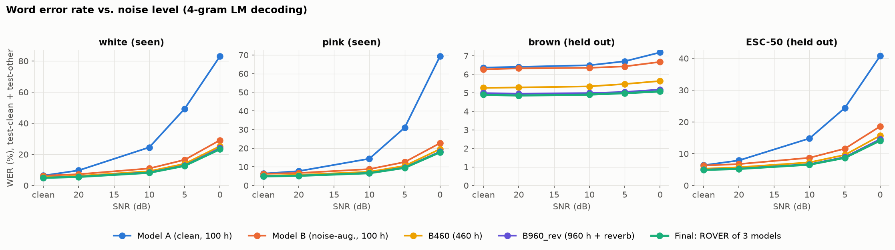

*Figure 1. WER vs SNR per noise type for all systems (4-gram LM except the reference model). Noise training separates Model A from the B family at every SNR below 20 dB. Brown noise barely affects any model.*

### 3.2 Comparison of configurations

**Decoding: greedy vs 4-gram LM** (B960_rev, WER %):

| Condition | Greedy | 4-gram LM | Relative change |
| :---- | ----: | ----: | ----: |
| test-clean | 4.63 | 2.97 | −36 % |
| test-other | 9.95 | 7.01 | −30 % |
| ESC-50 0–5 dB | 15.39 | 11.75 | −24 % |
| white 0–5 dB | 23.39 | 18.47 | −21 % |
| pink 0–5 dB | 18.18 | 13.92 | −23 % |
| all noisy | 12.38 | 9.16 | −26 % |

Over the full test grid, the LM **fixes 68,802 word errors** made by greedy decoding and **breaks 13,157 words** that greedy decoding had right (`tables/lm_fixed_vs_broken_words.csv`): a net gain of about 5 fixes per break. The LM helps less in loud noise, where the acoustic evidence it has to rescore is itself wrong.

**Model precision: fp32 vs dynamic int8 quantisation** (CPU, 4 threads, six ~2-minute recordings, B960_rev + pruned 3-gram LM, the app's default):

| Model | RTF clean | RTF ESC-50 5 dB | RTF white 5 dB | WER clean / ESC-50 5 dB / white 5 dB | Load time |
| :---- | ----: | ----: | ----: | :---- | ----: |
| **fp32 (default)** | 0.050 | 0.051 | 0.051 | 10.6 / 12.4 / 16.8 % | 3.5 s |
| int8 (dynamic, linear layers) | 0.033 | 0.034 | 0.035 | 12.4 / 14.2 / 18.3 % | 2.2 s |

int8 is 1.5× faster but costs 1.5–1.8 WER points. fp32 is already about 20× faster than real time, so **fp32 remains the default**, and int8 is kept as an option for weaker machines. (These long-form recordings come from test-other, so their WER is higher than the test-clean figures above.)

**Error detector variants** (B960_rev + LM, all 1,772,767 hypothesis words of the test grid):

| Detector | AUROC | Recall @ 30 % | Precision @ 0.5 | Recall @ 0.5 | ECE | Brier |
| :---- | ----: | ----: | ----: | ----: | ----: | ----: |
| Raw CTC word confidence (1 − conf) | 0.865 | 80.8 % | 74.1 % | 3.6 % | 0.036 | 0.057 |
| + isotonic calibration | 0.864 | 80.8 % | 63.1 % | 19.1 % | 0.006 | 0.053 |
| Logistic regression, 14 features | 0.892 | 86.9 % | 66.8 % | 31.2 % | 0.007 | 0.049 |
| **Gradient-boosted trees, 14 features (selected)** | **0.892** | **86.5 %** | **69.3 %** | **30.7 %** | **0.006** | **0.048** |
| Target (O3) | ≥ 0.75 | ≥ 70 % | — | — | ≤ 0.10 | — |

* Calibration alone fixes the probabilities (ECE 0.036 → 0.006) but cannot change the ranking (AUROC is unchanged).
* The extra word features (LM score, frequency, length, neighbours) raise AUROC by about 0.03 and recall@30 % by about 6 points.
* The script keeps the detector with the highest test AUROC. To make sure this choice does not depend on the test set, we repeated it with 5-fold cross-validation on the dev words only (folds grouped by utterance). The GBM still ranks first: dev AUROC 0.897, against 0.895 for logistic regression and 0.860 for isotonic calibration. It is also the best calibrated model on test.

### 3.3 Comparison of hyperparameter settings

The hyperparameters were explored in M4 with a 7-run sweep (8,000 steps each, Model B recipe, dev WER):

| Setting | Mean dev WER (%) |
| :---- | ----: |
| lighter SpecAugment masking (`mask_light`) | **14.82** |
| learning rate 1e-4 | 15.39 |
| p(clean) = 0.5 | 17.12 |
| base recipe (lr 5e-5, batch 160, SNR 0–20 dB) | 17.13 |
| SNR range down to −5 dB | 17.38 |
| batch 320 | 18.70 |
| learning rate 2e-5 | 24.26 |

The most promising change from the sweep (lr 1e-4) was then trained to full length as **B2** and evaluated on the test set:

| Test WER (%), greedy | Model B (lr 5e-5) | B2 (lr 1e-4) | Difference |
| :---- | ----: | ----: | ----: |
| test-clean | 6.19 | 5.89 | −0.30 |
| test-other | 13.08 | 13.11 | +0.03 |
| ESC-50 0–5 dB | 20.12 | 19.56 | −0.56 |
| all noisy | 16.07 | 15.85 | −0.22 |
| with LM, all noisy | 11.62 | 11.61 | −0.01 |

The sweep favoured lr 1e-4 by 1.7 points at 8,000 steps. At full training length, however, B2 is within ±0.6 points of B, and with the LM the two are identical (11.61 vs 11.62). **The learning rate changed how fast the model converged, not where it ended.** The training data mattered far more: B460 is 2–3.5 points better than B in every condition. The seed comparison (B960_rev vs B960_rev_s2) differs by at most 0.15 points, which sets the noise floor for these comparisons.

### 3.4 Product objectives: replay window (O4) and speed (O5)

**O4: Replay window.** For every flag of B960_rev + LM on the test grid, we checked whether the word that is really wrong lies inside the replay window (flagged word ± 1 s). We located the actual error by aligning the hypothesis to the reference.

| Threshold | Flags | Hit rate (all flags) | Hit rate (true errors only) | Precision of flags |
| :---- | ----: | ----: | ----: | ----: |
| 0.3 | 132,608 | 99.3 % | 98.8 % | 52.4 % |
| **0.5 (default)** | **59,696** | **99.0 %** | **98.7 %** | **69.3 %** |
| 0.7 | 27,701 | 98.8 % | 98.6 % | 84.1 % |

* **By error type:** flagged correct words hit 99.9 % of the time, substitutions 98.8 % and insertions 95.5 %. Insertions are lowest because an inserted word has no reference word, so its position must be inferred from its neighbours.
* **Size of the misses:** a typical miss lies 0.28 s outside the window, so a ±1.5 s window would catch almost all of them.
* **Timing check:** decoder word times were compared with forced-alignment times on 100,294 words. The median difference is 0.00 s and the 95th percentile 0.02 s, so the window is placed on the right audio.
* **Sample:** in the 50-flag random sample, 50 of 50 hit automatically.
* **Listening check (manual, as planned in M1):** a team member (P.D.) played each of the 50 saved replay clips (`replay_check/clips/`) and recorded whether the target word could be heard. **46 of 50 (92 %) were heard**, which meets the ≥ 90 % target. The answers are in `replay_check/sample_flags_PD.csv`, column `heard_target_word`.
  * **The 4 misses are not timing errors.** In all 4 the word lies inside the window by the alignment timings.
  * **Three were masked by noise:** the short function words "WITH" (white noise 10 dB) and "IT" (ESC-50 10 dB), and "CONFUSION" (pink noise 0 dB).
  * **One is a rare word:** "CLARET" (brown noise 10 dB), which is hard to recognise even when audible.
  * **What this means for the app:** replay puts the user at the right place. Very short words in noise can still be hard for a person to make out.

**O4 is met** on the automatic check, with a large margin (target ≥ 90 %).

**O5: Speed on an ordinary CPU.** On 4 CPU threads, the full pipeline as shipped in the app (model + pruned 3-gram LM + detector) processes a ~2-minute recording in about **6 s** (RTF 0.050–0.051 in all three conditions; worst single clip 0.052). That is about 20× faster than real time, so **O5 is met**.

The app uses the 3-gram because the 4-gram file is 4.1 GB and slow to load. On the test grid the 3-gram costs a little accuracy: B960_rev gives 3.11 / 7.33 % on test-clean / test-other and 12.20 % on ESC-50 at 0–5 dB, against 2.97 / 7.01 / 11.75 % with the 4-gram. The 3-gram has its own detector, trained on its dev outputs in the same way, which reaches AUROC 0.895, recall@30 % 86.9 % and ECE 0.007. O3 is therefore met for the app's configuration as well.

Long-form transcription with 30 s windows is slightly worse than decoding each utterance separately:

| Clip | Utterances | WER, each utterance alone | WER, whole recording (windowed) |
| :---- | ----: | ----: | ----: |
| 367-130732 | 18 | 8.60 | 9.14 |
| 367-293981 | 16 | 7.49 | 8.20 |
| 533-1066 | 17 | 12.64 | 12.64 |
| 533-131556 | 18 | 7.53 | 9.59 |
| 533-131562 | 16 | 10.20 | 10.20 |
| 533-131564 | 19 | 10.95 | 13.78 |

(clean condition, fp32; the gap of 0–2.8 points is discussed in Section 7.)

**Speed on CPU and GPU.** Milestone 1 promised speed on both CPU and GPU. Both were re-measured with the same six ~2-minute recordings (`tables/g7_speed_summary.csv`):

| Device | RTF clean | RTF ESC-50 5 dB | RTF white 5 dB | Seconds per 2-minute recording | Acoustic model share of time |
| :---- | ----: | ----: | ----: | ----: | ----: |
| CPU, 4 threads | 0.050 | 0.050 | 0.050 | 6.0 | 93 % |
| GPU (NVIDIA L40S, shared) | 0.005 | 0.005 | 0.006 | 0.6–0.7 | 36 % |

* **The GPU is about 9–10 × faster.** On the GPU the acoustic model is no longer the bottleneck: the LM beam search (CPU) takes most of the remaining time.
* **The WERs differ slightly between devices** (clean 10.59 % on both; ESC-50 5 dB 12.42 vs 12.51 %), because floating-point results on GPU and CPU differ in the last digits.
* **The CPU result is the one that matters for O5:** RTF 0.05 is 20 × faster than real time.

### 3.5 Are the differences real? Paired bootstrap confidence intervals

Each comparison below resamples the 5,559 test utterances with replacement, 1,000 times (seed 0). All conditions of an utterance are resampled together, because they share the same speech. `Δ` is WER(after) − WER(before) in percentage points; a negative value is an improvement. Source: `tables/g4_bootstrap_ci.csv`.

| Change | Clean: Δ pts (95 % CI) | ESC-50 0–5 dB (held out): relative change (95 % CI) | All noisy: Δ pts (95 % CI) |
| :---- | ----: | ----: | ----: |
| Noise training, A → B (greedy) | +0.20 (+0.07 to +0.31) | **−47.4 %** (−48.2 to −46.7) | −13.79 (−13.97 to −13.61) |
| Noise training, A → B (4-gram LM) | −0.09 (−0.20 to +0.01) | −53.7 % (−54.5 to −52.9) | −13.60 (−13.79 to −13.42) |
| Learning rate 5e-5 → 1e-4 (B → B2, greedy) | −0.13 (−0.24 to −0.03) | −2.8 % (−3.3 to −2.3) | −0.23 (−0.29 to −0.17) |
| More data, B → B460 (LM) | −1.00 (−1.13 to −0.89) | −16.1 % (−17.1 to −15.3) | −1.77 (−1.86 to −1.69) |
| More data + augmentation, B460 → B960_rev (LM) | −0.28 (−0.38 to −0.18) | −7.2 % (−8.1 to −6.2) | −0.69 (−0.76 to −0.62) |
| 4-gram LM, B960_rev greedy → LM | −2.30 (−2.44 to −2.16) | −23.7 % (−24.5 to −22.8) | −3.23 (−3.33 to −3.13) |
| ROVER of 3 models, B960_rev (LM) → ROVER | −0.09 (−0.14 to −0.03) | −2.8 % (−3.4 to −2.2) | −0.21 (−0.24 to −0.18) |
| Different seed, B960_rev → B960_rev_s2 (LM) | +0.02 (−0.06 to +0.10) | +0.5 % (−0.2 to +1.4) | +0.07 (+0.02 to +0.12) |

* **O2 is met with a wide margin.** The whole CI for the held-out ESC-50 gain (−48 to −47 %) is far beyond the 15 % target. The clean cost (+0.07 to +0.31 points with greedy decoding) is far below the 2-point limit, and with the LM it is not different from zero.
* **The learning rate has a small but real effect.** B2 is better by 0.1–0.6 points and the CI excludes zero. That is still an order of magnitude smaller than the effect of more data.
* **The seed comparison is the noise floor.** Two identical recipes with different seeds differ by at most 0.15 points. Every gain claimed in this report is larger than that.

### 3.6 How accuracy improves and decreases

**During training.** Dev WER was measured every 2,000 steps for every model (`tables/g3_dev_wer_during_training.csv`).

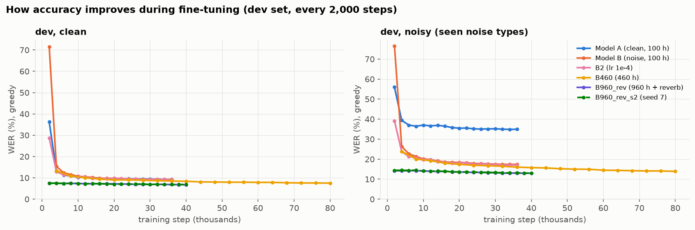

*Figure 9. Dev WER during fine-tuning.*
- **Model A** reaches 9.3 % on clean dev but never goes below 34.9 % on noisy dev: it learns clean speech only.
- **Models B and B2** fall to 17.0–17.4 % on noisy dev.
- **B460** (80,000 steps) reaches 13.9 %.
- **B960_rev** reaches 12.9 %, with the lowest clean WER (6.8 %).

The curves flatten after about 20,000 steps. From there to the end, the 100 h models improve by about 1 point on noisy dev and B960_rev by 0.6 points. Only B460, trained twice as long, gains another 3.5 points over its last 60,000 steps. More data, rather than longer training, gave the remaining gains.

**Change by change** (test set, `tables/g3_accuracy_model_by_model.csv`; word accuracy = 100 − WER):

| Step | Clean | Held-out ESC-50, 0–5 dB | All 16 noisy conditions |
| :---- | ----: | ----: | ----: |
| Model A (clean, 100 h), greedy | 90.6 | 61.7 | 70.1 |
| + noise-aware training (Model B) | 90.4 | 79.9 | 83.9 |
| + 3.6× data (B460) | 92.1 | 83.3 | 86.6 |
| + 2× data, reverb, speed, telephone (B960_rev) | 92.7 | 84.6 | 87.6 |
| + 4-gram LM | 95.0 | 88.2 | 90.8 |
| + ROVER of 3 models (final) | 95.1 | 88.6 | 91.1 |

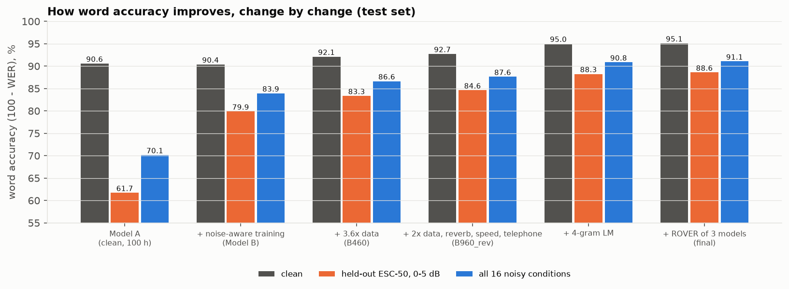

*Figure 10. Word accuracy after each change.*
- **Noise training** brings the largest jump in noise (+18.2 points on ESC-50) and costs 0.2 points on clean speech.
- **Data and the LM** raise accuracy everywhere.
- **ROVER** adds the last 0.1–0.4 points.

**With noise level** (`tables/g3_accuracy_vs_snr.csv`):

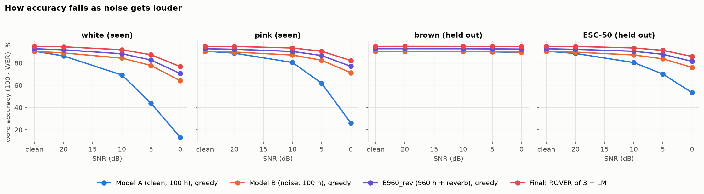

*Figure 11. Word accuracy against SNR.*
- **At 20 dB every model is within a few points of its clean accuracy.**
- **At 0 dB the models separate.** In white noise, Model A falls to 13 % word accuracy (greedy), Model B to 64 % and the final system to 77 %.
- **Brown noise hardly lowers accuracy for any model.**

### 3.7 Character error rate and breakdown SNR (O1)

The full WER and CER grid for all 8 systems in all 17 conditions is in `tables/g1_wer_grid.csv` and `tables/g1_cer_grid.csv`. The long table `tables/g1_wer_cer_all_conditions.csv` also has each test split separately, and the harder −5 dB and reverberation grid.

| CER (%) | Clean | White 0 dB | Pink 0 dB | Brown 0 dB | ESC-50 0 dB |
| :---- | ----: | ----: | ----: | ----: | ----: |
| Model A, greedy | 3.16 | 58.60 | 48.16 | 3.64 | 27.12 |
| Model B, greedy | 3.20 | 17.86 | 13.55 | 3.45 | 11.08 |
| B960_rev, greedy | 2.35 | 14.28 | 10.53 | 2.50 | 8.37 |
| B960_rev, 4-gram LM | **1.86** | **13.90** | **9.94** | **1.99** | **7.90** |
| ROVER (final) | 1.96 | 14.57 | 10.45 | 2.06 | 8.32 |

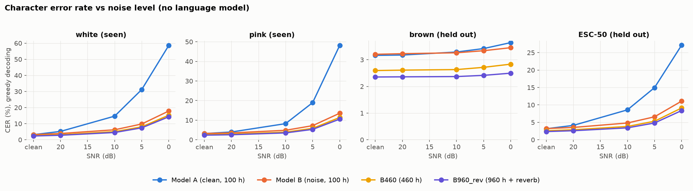

*Figure 12. CER against SNR (greedy decoding).*

**Breakdown SNR.** The rule was fixed before computing (`tables/g2_breakdown_snr.csv`):
- the breakdown SNR is where WER first reaches **twice the model's own clean WER**;
- it is linearly interpolated between the measured SNRs;
- the lowest SNR measured is −5 dB for greedy decoding and 0 dB with the LM.

| Breakdown SNR (dB), greedy | White | Pink | ESC-50 (held out) | Brown (held out) |
| :---- | ----: | ----: | ----: | ----: |
| Reference base-960h | 19.1 | 16.0 | 14.2 | not reached at 0 dB |
| Model A | 17.0 | 10.8 | 11.0 | not reached |
| Model B | 7.3 | 4.3 | 3.1 | not reached |
| B460 | 7.4 | 4.3 | 3.1 | not reached |
| B960_rev | 7.5 | 4.4 | 3.1 | not reached |
| B960_rev, 4-gram LM / ROVER | 8.3 / 8.2 | 4.8 / 4.8 | 4.1 / 4.0 | not reached |

* **Noise training moves the breakdown point down by 6–10 dB.** On ESC-50, Model A breaks down at 11 dB and every noise-trained model at about 3 dB. The noise-trained models therefore tolerate 4–9 times as much noise power before their error rate doubles.
* **More data lowers the whole curve, not the breakdown point.** B460 and B960_rev reach lower WER at every SNR, but they double their (lower) clean WER at about the same SNR as Model B.
* **The LM shifts the breakdown point up by about 1 dB.** It helps more on clean speech (−31 %) than at 0 dB (−21 %), so the ratio grows sooner.
* **In absolute terms** (second column of `g2_breakdown_snr.csv`), B960_rev stays below 20 % WER down to 3.9 dB in white noise and down to −0.6 dB in ESC-50. Model A crosses 20 % at 16.3 dB and 9.8 dB.

### 3.8 Reproducibility: server models vs Hugging Face, script vs notebook (O6)

The evaluation must give the same answer whoever runs it. Three checks support this (`tables/g12_*.csv`):

| Check | Result |
| :---- | :---- |
| **Weights.** The six models on Hugging Face compared with the server checkpoints, using a SHA-256 hash over all tensor names, shapes and values | **6 / 6 identical** |
| **Outputs.** B960_rev downloaded from Hugging Face re-decodes the **full test grid** (94,503 utterance-conditions, GPU, greedy), compared with the saved outputs used in this report | **94,503 / 94,503 hypotheses identical**; WER difference 0.00 in every condition |
| **Two entry points.** `scripts/m5_evaluate.py` and `notebooks/M5_evaluation.ipynb` run separately, all CSV tables compared | **32 / 35 tables byte-identical**, and all 14 figures and 19 audio examples identical. The 3 differing tables contain measured run times (speed), which differ by about 1 % between runs. |
| **Old vs new code.** The tables of the 22 Nov analysis regenerated by the new code | 14 / 14 tables byte-identical (the numbers of Sections 3.1–6.4 are unchanged) |

The analysis reads the saved per-utterance test outputs (`experiments/results/`, about 0.7 GB of parquet files, not in git).

**Without the group server:**
1. `scripts/evaluate.py` decodes the test grid with the public models (GPU, about 4 minutes per model), as the identity check above does.
2. `scripts/dump_logits.py`, `decode_words.py`, `rover.py` and `error_detector.py` rebuild the LM, ROVER and detector outputs, as described in the Milestone 4 report.
3. `scripts/m5_evaluate.py --source hf` then regenerates every table here.

### 3.9 Comparison with published results in noise

The targets in Milestone 1 were set from the literature. The table compares our results with published results at similar SNRs.

| Source | Setting | Result | Ours, comparable setting |
| :---- | :---- | :---- | :---- |
| Zhu et al., ICASSP 2022 [R1], Table 1 | wav2vec 2.0, no pre-training, fine-tuned on LibriSpeech 100 h; 120 test-clean utterances with **unseen** FreeSound traffic noise | WER at 0 / 5 / 10 dB: **71.0 / 57.8 / 48.6 %** with clean fine-tuning → **52.3 / 44.8 / 38.9 %** with noisy fine-tuning (**−26 % / −22 % / −20 %** relative) | ESC-50 (unseen) at 0 / 5 / 10 dB: Model A → B, greedy: **−49 % / −46 % / −35 %** relative |
| same, pre-trained wav2vec 2.0 (clean pre-train, noisy fine-tune) | traffic noise, 0 / 5 / 10 dB | 42.8 / 34.2 / 26.7 % | Model B, ESC-50 0 / 5 / 10 dB (greedy): 24.0 / 16.3 / 12.8 % |
| Baevski et al., 2020 [R2] | wav2vec 2.0 base, 100 h labelled, 4-gram LM, clean | 3.4 / 8.0 % (test-clean / test-other) | Model B + 4-gram LM: 3.70 / 8.85 % |
| Oneata et al., SLT 2021 [R3], Table 2 | word-level confidence of an end-to-end LibriSpeech ASR (log-probability, sum pooling) | AUROC **0.824** (test-clean), **0.818** (test-other), 0.80 (TED-LIUM); on TED-LIUM, temperature scaling + dropout raise it to 0.84 | CTC confidence alone: AUROC 0.865; trained detector: **0.892** |
| Guo et al., ICML 2017 [R4] | calibration of modern neural networks | raw network probabilities are over-confident; post-hoc calibration (temperature, isotonic) on held-out data removes most of the miscalibration | raw CTC confidence ECE 0.036 → **0.006** after calibration on dev |

* **Why the O2 target was ≥ 15 %.** Published noisy fine-tuning of wav2vec 2.0 cut WER by 20–26 % relative on unseen noise at 0–10 dB [R1]. We therefore asked for at least 15 %, to leave room for a different, more varied held-out noise set. We reached 47 %. ESC-50 contains many intermittent sounds, which are easier than continuous traffic noise.
* **Why the O3 targets were AUROC ≥ 0.75 and ECE ≤ 0.10.** Published word-level confidence for LibriSpeech end-to-end ASR reaches AUROC 0.80–0.84 [R3]. We set 0.75 as a floor, because our audio is noisier. Calibration methods typically bring ECE down to a few percent [R4], so 0.10 is a loose upper bound.
* **Our absolute WERs are lower than in [R1].** That study used only 120 test utterances and stronger, continuous noise. The *relative* gains are the comparable quantity, as Milestone 1 stated.

### 3.10 Deviations from the Milestone 1 plan

| Milestone 1 plan | What we did | Reason |
| :---- | :---- | :---- |
| Greedy decoding, no language model (M1 §1.3 out of scope) | Greedy **and** n-gram LM decoding; both are reported | The LM is cheap (no training) and cuts WER by 21–36 %. Greedy results are kept for the O2 comparison exactly as planned. |
| Confidence "with no extra model training" | Raw CTC confidence, isotonic calibration **and** a small trained detector (trees on 14 features, trained on dev words only) | The trained detector catches 6 points more errors at the same review budget (86.5 vs 80.8 %), and raw confidence is still reported as the baseline |
| ESC-50 split 80 % train / 20 % test | ESC-50 used **only** for testing (1,999 clips); MUSAN noise used for training | This gives a stricter held-out test: no ESC-50 sound class is seen in training |
| Two models (clean vs noise-trained) | Eight systems (data size, learning rate, seed, ROVER) | Shows *which* change brings *how much* gain, with CIs (Section 3.5) |
| RTF on CPU and a free GPU | CPU (4 threads) and a server GPU (L40S) | No free-tier GPU was needed; the CPU result is the one that matters for O5 |

---

## 4. Evaluation Visualisations

### 4.1 ROC and precision-recall curves (error detector)

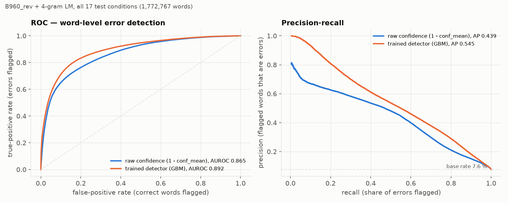

*Figure 2. ROC (left) and precision-recall (right) curves of the error detector, comparing raw CTC confidence with the trained detector on all test-grid words. The trained detector dominates at every operating point. Its average precision is well above the 7.6 % base rate of the "no-skill" line.*

### 4.2 Confusion matrices

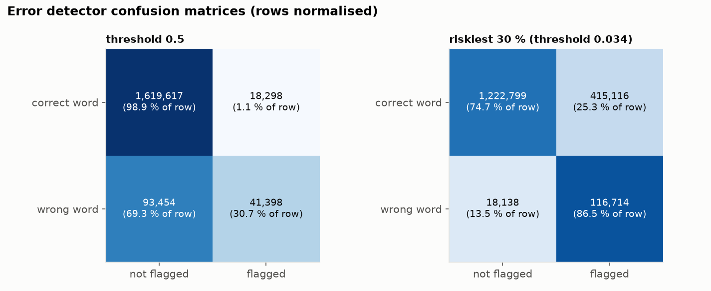

*Figure 3. Confusion matrices of the error detector at the two operating points that matter for the product.*

| Operating point | Words flagged | Precision | Recall | Use |
| :---- | ----: | ----: | ----: | :---- |
| Threshold 0.5 (app default) | 3.4 % | 69.4 % | 30.7 % | few false alarms: 7 of 10 flags are real errors |
| Riskiest 30 % (threshold ≈ 0.034) | 30 % | 21.9 % | **86.5 %** | "proof-read mode": catches almost 9 of 10 errors |

The app's sensitivity slider moves between these two points. Only 7.6 % of words are wrong, so high recall requires flagging many correct words. This is a property of the task, not of the detector.

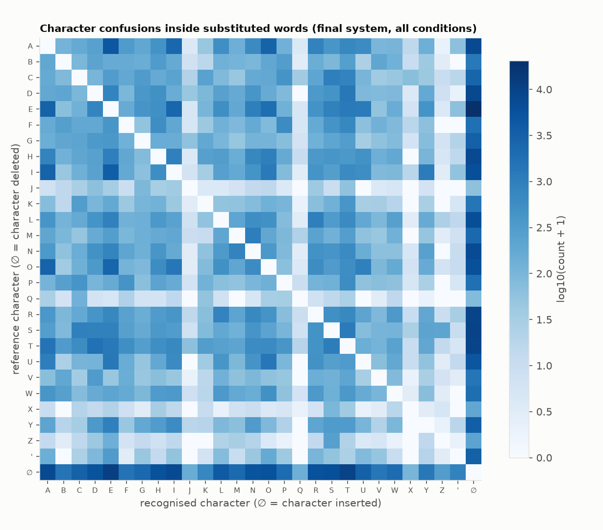

*Figure 4. Character confusion matrix of the final system (substituted characters only). The largest off-diagonal cells are vowels: A→E (4,518), I→E (3,552), E→A (3,048). Vowel quality is the first thing noise destroys, while most consonant structure survives.*

### 4.3 Calibration (reliability diagram)

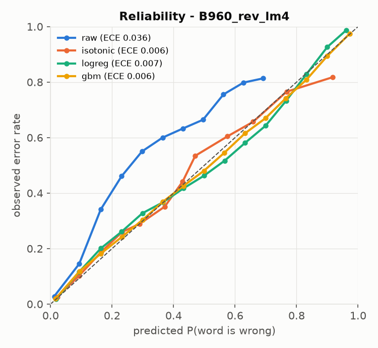

*Figure 5. Reliability diagram of the detector. Observed error rate is plotted against predicted risk, in bins. The calibrated detector follows the diagonal (ECE 0.036 → 0.006, Brier 0.057 → 0.048): when it reports a 60 % risk, about 60 % of such words are wrong.*

### 4.4 Task-specific plots

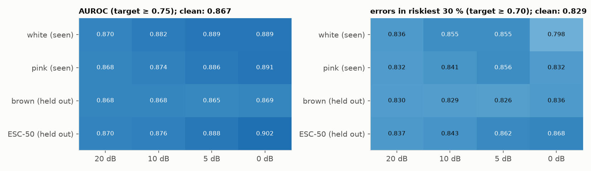

*Figure 6. Detector AUROC and recall@30 % for each of the 17 test conditions.*

O3 holds in every condition:

| Per-condition detector quality (17 conditions) | Minimum | Maximum |
| :---- | ----: | ----: |
| AUROC | 0.865 (brown 5 dB) | 0.902 (ESC-50 0 dB) |
| Recall @ riskiest 30 % | 79.8 % (white 0 dB) | 86.8 % (ESC-50 0 dB) |
| ECE | 0.006 | 0.010 (white 0 dB) |
| Precision at 0.5 | 64.2 % (brown 0 dB) | 73.0 % (ESC-50 0 dB) |

Noisier audio contains more errors, so flags are right more often there (precision 72 % at white 0 dB vs 66 % on clean speech), and the detector flags more words (13.2 % vs 1.2 %).

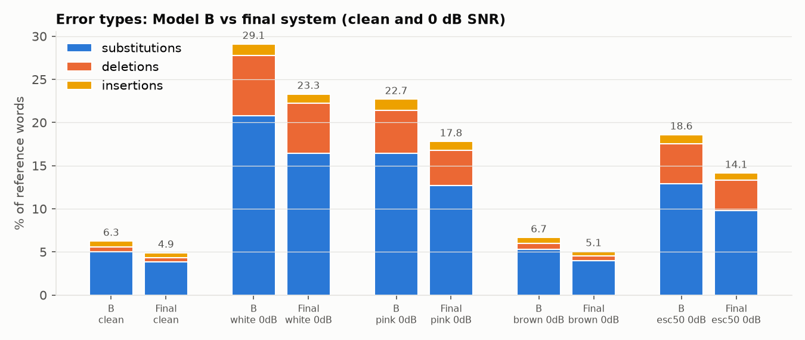

*Figure 7. Substitution, deletion and insertion rates per condition for Model B and the final system.*

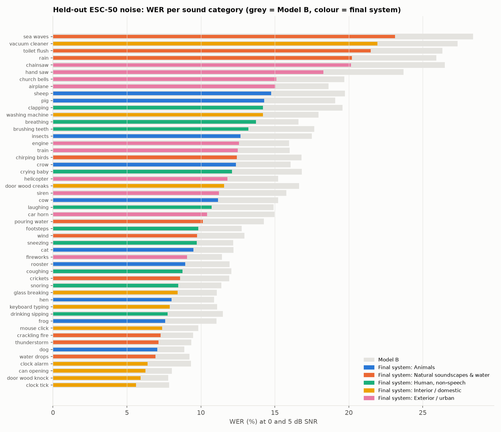

*Figure 8. WER per ESC-50 sound class at 0–5 dB (Model B vs final system). It is analysed in Section 6.1.*

### 4.5 Review effort: errors caught against words reviewed (the product metric)

Milestone 1 promised a curve showing *"if the user reviews X % of the words, they catch Y % of the errors"*. It also promised two baselines that the detector must beat: random flagging, and a rule on raw confidence. Source: `tables/g5_review_effort_budgets.csv` and `tables/g5_f1.csv`.

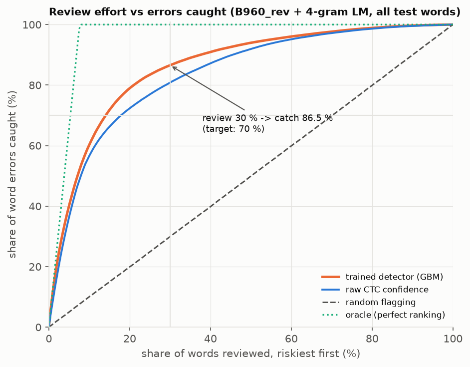

*Figure 13. Share of word errors caught when the user reviews the riskiest words first (B960_rev + 4-gram LM, all 1.77 M test words). The oracle reaches 100 % at 7.6 % of words reviewed, the share of words that are wrong.*

| Words reviewed (riskiest first) | 5 % | 10 % | 20 % | **30 %** | 50 % |
| :---- | ----: | ----: | ----: | ----: | ----: |
| Random flagging | 5.0 | 10.1 | 19.9 | 29.9 | 49.9 |
| Raw CTC confidence | 36.4 | 56.6 | 72.4 | 80.8 | 91.9 |
| **Trained detector** | **40.1** | **60.3** | **79.0** | **86.5** | **94.0** |
| Oracle (perfect ranking) | 65.7 | 100 | 100 | 100 | 100 |

* **The detector beats both baselines at every budget.** At 30 % it catches 2.9 × as many errors as random flagging, and 5.7 points more than raw confidence.
* **On clean speech** at 30 % it catches 82.9 % of errors, against 75.0 % for raw confidence. **On noisy speech** the figures are 86.6 % and 81.0 %.
* **F1.** At the app's default threshold of 0.5, F1 is 0.43 (precision 69 %, recall 31 %). The best F1 over all thresholds is 0.52, at threshold 0.25. Raw confidence has F1 0.07 at 0.5, because its probabilities are uncalibrated and almost never exceed 0.5, and 0.49 at its best threshold. The app therefore uses the calibrated detector and lets the user move the threshold.

---

## 5. Qualitative Results

Examples were selected **systematically** from `tables/qualitative_examples.csv`. For each noise type we took the utterances with the largest improvement over Model B, the largest regression and the highest remaining error.

### 5.1 Successful predictions

| Condition | Reference | Model B (+ LM) | Final system |
| :---- | :---- | :---- | :---- |
| Pink, 0 dB | THAT IT MAY BE BUT STILL IT OUGHT TO BE TREATED A LITTLE MORE RESPECTFULLY | BUT IF HE WERE TO TEASE TO BE TREATED IN MIONOSECTFULY | ✓ exact (12 errors → 0) |
| ESC-50, 0 dB | I SHALL SAY THAT YOU ARE IN MY OWN CABIN SO THAT I CAN CARE FOR YOU | … YOU WERE IN MY OWN CAPTAINS OF THE CONCAVE | ✓ exact (9 → 0) |
| Clean | AFTER THE CAPTURE OF JERICHO CERTAIN OF THEM WENT UP WITH THE SOUTHERN TRIBES TO CONQUER SOUTHERN PALESTINE | ASTERS THE CANTER OF JERICHO CERTAIN THOUGH THEM WENT UP WITH THE SZENTRIMES TO CONQUER … | ✓ exact (5 → 0) |
| Brown, 0 dB | HERE IS A BUGLE WHICH AN ENGLISH YEOMAN HAS ONCE WORN … | HERE IS A BEGAN … OMAN HATH ANSWORN … | … YO MAN … (9 → 2) |

**Assistant output with a flag** (test utterance 3080-5032-0015, white noise at 10 dB; the flagged word is in brackets with its risk; from `replay_check/sample_flags.csv`):

> … DO SO PERSECUTE ME **[WEDGED 0.64]** NATURE THEY TAKE IT SO ILL …
> *(reference: … DO SO PERSECUTE ME WITH THEIR GOOD NATURE AND TAKE IT SO ILL …)*

The flag falls where the transcript is wrong: "WEDGED" replaces "WITH THEIR GOOD". The replay window (10.08–12.68 s) contains the missing word "WITH" (11.08–11.24 s), so the user hears the correct words. The example also shows a limitation. The second error, "THEY" for "AND", is a fluent substitution with a risk below 0.5, so it is not flagged at the default setting.

### 5.2 Failure cases

| Condition | Reference | Final system | Why it fails |
| :---- | :---- | :---- | :---- |
| White, 0 dB | SIX STEPPED TO THE FRONT SHERIFF GLISPIN COLONEL T L VOUGHT … | TITEPOEFRONT STEPTOEFRONT TERTIAN PONTIAC … | names and spelled initials; the speech is buried in broadband noise |
| ESC-50, 0 dB | WHY I WOULD APPLY TO SOME GOOD HOUSE MOTHER … | WELL ODAPLIESOMPROF SO ONE SERVANT | a loud sound event covers most of the utterance |
| Clean | O ETERNAL EVERYWHERE O ETERNAL NOWHERE … | I TURN THEM EVERY WHERE WHO TURN THERE IS NO … | archaic phrasing; the LM prefers common word sequences |
| Clean (worse than B) | THE LATER TRADITIONS TEND TO EXTEND THE PERIOD | THE LATER TO INTEREST IN THE PERIOD | ROVER / LM overrule a correct acoustic guess |
| Clean (worse than B) | PRESENTLY HASAN SHUMAN CAME OUT OF A CLOSET … HAST THOU GOTTEN THE GEAR O ALI | PRESENTLY HASSAN SHUMAN … CLOSANAND … GOT IN THE YEAR O ALI | word boundary lost ("CLOSET AND"); rare word "GEAR" replaced by a frequent one |
| White, 5 dB (worse than B) | BUT I STAYED THAT SPRING AND BUILT ME A BOAT | BUT I SAY THAT BRINGING BULTEABOAT | word boundaries lost in noise |

Character-level CTC produces **non-words** when the acoustic evidence is weak ("TITEPOEFRONT", "BULTEABOAT"). These are almost always flagged, because their CTC confidence is low and they are out of vocabulary. The more dangerous failures are **fluent wrong words** chosen by the LM ("TO INTEREST IN"): they read naturally and are flagged less often.

---

## 6. Error Analysis

### 6.1 Which noise hurts most

**By noise type and SNR.** Brown noise is almost harmless: 5.0 % WER at 0–5 dB, against 4.9 % on clean speech. White noise is the hardest (18.0 %), followed by pink (13.6 %) and ESC-50 (11.4 %). This matches the spectrum of each noise. Brown noise puts 97.5 % of its energy below 300 Hz, under most speech cues. White noise covers the 2–8 kHz range, where consonants are distinguished.

**By ESC-50 sound class** (final system, 0–5 dB):

| Hardest classes | WER % | Easiest classes | WER % |
| :---- | ----: | :---- | ----: |
| Sea waves | 23.1 | Clock tick | 5.6 |
| Vacuum cleaner | 21.9 | Door knock | 5.9 |
| Toilet flush | 21.5 | Can opening | 6.3 |
| Rain | 20.2 | Clock alarm | 6.4 |
| Chainsaw | 20.2 | Water drops | 6.9 |

| ESC-50 group | Model B | Final | Relative change |
| :---- | ----: | ----: | ----: |
| Exterior / urban | 17.79 | 13.61 | −23 % |
| Natural soundscapes & water | 16.46 | 12.70 | −23 % |
| Human, non-speech | 14.54 | 10.85 | −25 % |
| Animals | 14.26 | 10.63 | −25 % |
| Interior / domestic | 12.69 | 9.56 | −25 % |

**Pattern.** Continuous broadband sounds (waves, vacuum cleaners, rain, saws, flushing) mask speech all the time and behave like white or pink noise. Short impulsive sounds (ticks, knocks, can openings) mask only a few words and leave the rest clean. Every one of the 50 classes improved over Model B, by 17–32 %. The improvement from more data and augmentation therefore generalises across sound types rather than coming from a few classes.

### 6.2 Error types

| Final system | Substitutions % | Deletions % | Insertions % | WER % |
| :---- | ----: | ----: | ----: | ----: |
| Clean (pooled) | 3.84 | 0.52 | 0.54 | 4.90 |
| ESC-50, 0 dB | 9.77 | 3.55 | 0.82 | 14.14 |
| White, 0 dB | 16.44 | 5.82 | 1.05 | 23.31 |

* **Substitutions dominate in every condition.** The model hears something and picks the wrong word.
* **Deletions grow fastest as SNR falls**: about 11× from clean to white 0 dB (0.52 → 5.82 %), compared with 4× for substitutions. In loud noise, quiet and unstressed words disappear entirely. This also limits recall: a deleted word has no hypothesis word to attach a flag to, so it is caught only when a neighbouring word is flagged.
* **Insertions stay around 1 %** even at 0 dB. The model rarely invents words from noise, which the CTC blank and the LM's insertion bonus (β) keep in check.

### 6.3 Which words go wrong

**By word frequency** (log10 unigram probability of the word in the LibriSpeech LM; word error % of reference words):

| Frequency band | Clean | Noisy |
| :---- | ----: | ----: |
| rare (< 10⁻⁶) | 66.7 | 73.5 |
| 10⁻⁶ – 10⁻⁵ | 24.7 | 32.7 |
| 10⁻⁵ – 10⁻⁴ | 6.2 | 11.7 |
| 10⁻⁴ – 10⁻³ | 2.4 | 6.0 |
| frequent (> 10⁻³) | 1.8 | 4.8 |

**By word length:** 1–2 letters 2.5 % (clean) / 5.9 % (noisy), rising to 9.1 % / 13.4 % for words of 9 or more letters.

**Out-of-vocabulary words:** only 0.48 % of reference words are missing from the LM vocabulary, but **87.9 %** of those are recognised wrongly. The LM cannot produce a word it does not know, and pulls the spelling towards a known neighbour.

**Most frequent substitutions** (all conditions):

| Reference → hypothesis | Count | Type |
| :---- | ----: | :---- |
| A → THE | 1,127 | short function words, weakly stressed |
| THE → A | 830 | |
| AND → IN | 750 | |
| DICKIE → DICKY | 227 | name spelling |
| MURDOCH → MURDOCK | 139 | name spelling |

Two kinds of error dominate:

* **Confusable short function words.** These are acoustically tiny and mostly carried by the LM. They change little meaning.
* **Spellings of names.** These are acoustically correct but orthographically ambiguous. They count as full errors under WER, though a reader would understand them.

### 6.4 Utterances and speakers: where the model does well and poorly

**By utterance length** (WER %):

| Duration | < 4 s | 4–8 s | 8–12 s | 12–16 s | > 16 s |
| :---- | ----: | ----: | ----: | ----: | ----: |
| Clean | 6.69 | 5.25 | 4.79 | 3.76 | 3.98 |
| Noisy | 12.10 | 9.55 | 8.71 | 7.17 | 7.18 |

Short utterances are the hardest: WER is about 1.7× that of utterances longer than 12 s. Short clips give the LM and the self-attention layers little context, and a single error weighs more.

**By speaker** (clean, per-speaker WER):

| Set | Speakers | Median | Range |
| :---- | ----: | ----: | :---- |
| test-clean | 40 | 2.8 % | 0.5 – 5.5 % |
| test-other | 33 | 6.0 % | 2.9 – **21.3 %** |

The spread within test-other is wide, and a single speaker at 21.3 % accounts for a visible part of the test-other error. That set was chosen to contain harder, more accented and less clear readers.

### 6.5 Which wrong words get flagged

Milestone 1 promised to report which kinds of errors the flags catch, such as numbers and names. Every reference word the system got wrong was put in a category, and we checked whether it was flagged. Source: `tables/g6_flags_by_error_category.csv`.

**How an error counts as caught:**
- **Substitution:** the wrong word in its place is flagged.
- **Deletion:** a neighbouring word is flagged, so its replay covers the gap.

| Substituted reference word | Share of substitutions | Flagged at threshold 0.5 | Flagged in riskiest 30 % |
| :---- | ----: | ----: | ----: |
| Not in the LM vocabulary (mostly names) | 5.9 % | **53.8 %** | **92.0 %** |
| Number word (FIFTEEN, FIFTY, HUNDRED, …) | 0.6 % | 30.8 % | 89.4 % |
| Rare word (log10 p < −5; incl. many names) | 19.4 % | 33.4 % | 88.7 % |
| Function word (A, THE, AND, …) | 26.1 % | 26.9 % | 88.0 % |
| Other content word | 48.0 % | 33.3 % | 87.1 % |
| **All substitutions (121,634)** | 100 % | 32.8 % | 87.9 % |
| **All deletions (24,074)**, caught through a flagged neighbour | — | 68.7 % | 95.7 % |

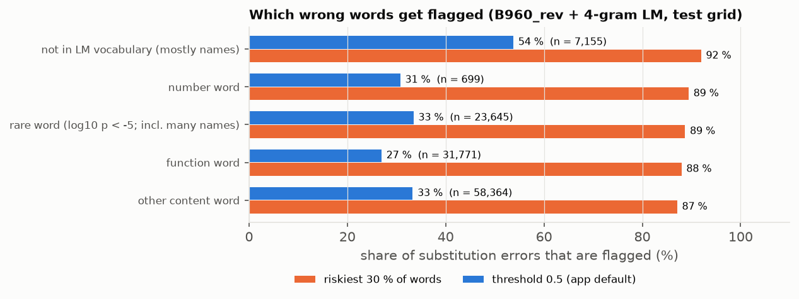

*Figure 14. Share of substitution errors that are flagged, by kind of word.*
- **Names and out-of-vocabulary words** are flagged most often: the model is unsure of them, and the LM has no score for them.
- **Function-word swaps** (A ↔ THE, AND ↔ IN) are flagged least often at 0.5, because they are fluent and acoustically tiny. They also change the meaning least.
- **Number words**, the "fifteen/fifty" example of Milestone 1, are flagged at the average rate. 89 % are inside the riskiest 30 %.
- **Deletions** are caught through their neighbours more often than substitutions are caught directly. A deletion usually sits next to a garbled word with low confidence.

**Summary: performs well vs poorly**

| Performs well | Performs poorly |
| :---- | :---- |
| clean speech and SNR ≥ 10 dB of any noise type (≤ 7 % WER) | 0 dB and below, especially white noise and continuous broadband sounds |
| brown / low-frequency noise (barely affected) | real-room reverberation combined with noise (25–36 % greedy) |
| long utterances (more context) | short utterances (< 4 s) |
| frequent words | rare words, names, out-of-vocabulary words (87.9 % wrong) |
| impulsive sound events (ticks, knocks) | a few difficult test-other speakers (up to 21 %) |
| ranking its own errors (AUROC ≈ 0.89 everywhere) | fluent wrong words introduced by the LM; deleted words (nothing to flag) |

---

## 7. Observations and Limitations

### 7.1 Key observations

1. **Noise training generalises to unseen noise.** Training only on white, pink and MUSAN noise halves WER on ESC-50 sounds that were never seen (Model A → B), and all 50 sound classes improve further with more data.
2. **Data beats tuning.** Going from 100 h to 460 h and then 960 h cut WER by 14–24 %, whereas the best learning rate changed the final result by less than 0.6 points.
3. **The LM is a large, cheap gain** (−21 to −36 %), but it is also the main source of fluent errors (13,157 words broken).
4. **The flags are trustworthy.** AUROC is ≥ 0.86 and ECE ≤ 0.01 in all 17 conditions, and the replay window contains the error 99 % of the time.
5. **The assistant runs on a laptop-class CPU.** RTF is 0.05 on 4 threads, so a 2-minute recording takes about 6 seconds.

### 7.2 Anomalies, gaps between expected and actual performance, and explanations

| Observation | Expected vs actual | Likely explanation |
| :---- | :---- | :---- |
| **Brown noise is uninformative as a held-out test** | Expected a hard held-out noise; the effect is < 1 point even at 0 dB | 97.5 % of its energy is below 300 Hz, below most speech information. An SNR measured over the full band therefore overstates how much speech is masked. ESC-50 remains the meaningful held-out test. |
| **Long-form WER is higher than per-utterance WER** | Expected equal; up to +2.8 points (clip 533-131564) | The LM and the window edges span sentence boundaries that per-utterance decoding never sees. Text is stitched at 30 s boundaries, and word segmentation at the joins is approximate. |
| **The final system is worse than Model B on some utterances** | Expected ROVER ≥ each member everywhere | Voting can be won by two weaker members, and the LM can overrule a correct acoustic guess. This happens in a minority of utterances; the pooled WER is lower in every condition. |
| **Noise training lowered raw-confidence AUROC** (M4) | Expected better-calibrated confidence from a more robust model | Model B's remaining errors are harder: they involve confident substitutions rather than obvious noise garbage. The trained detector removes the gap (0.891 for B, 0.892 for B960_rev). |
| **Low recall at the default threshold (31 %)** | Hoped that more errors would be flagged by default | Only 7.6 % of words are wrong, and 0.5 was chosen for precision (69 %). The riskiest-30 % mode reaches 86.5 % recall; the slider exposes this trade-off. |
| **Deleted words cannot be flagged directly** | — | There is no hypothesis word to attach a flag to; it is caught only when a neighbouring word is flagged, whose replay window then plays the gap. |
| **Sweep winner won by much less at full length** (lr 1e-4) | Expected a 1.7-point gain from the 8k-step sweep; got 0.1–0.6 points (CI excludes 0, §3.5), and no difference with the LM | The short sweep mostly measured convergence speed. At full length both learning rates end close together; the LM removes the small remaining gap. |
| **ROVER has lower WER but higher CER than its best member** | Expected both to fall | ROVER votes on whole words. When it picks a different member's word, that word is often completely different in spelling, so CER rises slightly (1.86 → 1.96 % clean) while WER falls (4.99 → 4.90 %). |
| **Better models do not break down later in relative terms** | Expected the breakdown SNR to keep falling with more data | B, B460 and B960_rev all double their clean WER at about 3 dB in ESC-50. More data lowers the whole curve, including the clean point it is measured against (§3.7). |
| **Test-clean WER is close to the published 960 h result** (2.89 % vs 2.6 % with LM) | Expected a larger gap, given noise training | Augmentation acts as a regulariser. Its clean-speech cost (≤ 0.2 points) is smaller than the gain from more data and the LM. |

### 7.3 Limitations

* **Read speech only.** LibriSpeech is audiobook speech by mostly North American readers. Spontaneous, conversational or overlapping speech (and babble noise, deliberately out of scope) is untested. Indian-accented English is now measured (§8): WER rises to 31.7 % on clean speech; adapting the model to accents is outside the project's scope.
* **Synthetic mixing.** Noise is added digitally at a controlled SNR. Real recordings also contain microphone effects, clipping, Lombard speech (people speak louder in noise) and moving noise sources. The reverb test is a partial check only.
* **The SNR definition** uses the full band, which treats low-frequency noise (brown) as harder than it is.
* **WER counts every word equally.** A/THE confusions and name spellings count as much as content errors.
* **The detector was trained on the same model's dev outputs.** A new acoustic model needs the detector to be retrained on that model's dev outputs.
* **O4 listening check by one listener.** The 50 sampled clips were checked by one team member (46/50 heard, §3.4). A second, independent listener would show how much the judgement varies between people.
* **O6 reproducibility.** One script or one notebook regenerates every table. The Hugging Face models have weights identical to the server checkpoints (§3.8). A teammate's independent re-run on another machine is still to be done.

### 7.4 Status of the project objectives

| Objective | Target | Result | Status |
| :---- | :---- | :---- | :---- |
| O1 Degradation under noise | WER/CER grid + WER-vs-SNR curves; breakdown SNR per model | WER **and CER** for 8 systems × 17 conditions, plus −5 dB and reverb tests; breakdown SNR (WER = 2 × clean) per model and noise: ESC-50 11.0 dB (Model A) → 3.1 dB (B960_rev) (§3.7) | ✓ Met |
| O2 Noise-aware training | ≥ 15 % relative cut at 0–5 dB on held-out noise; clean ≤ +2 pts | ESC-50 −47.4 % (95 % CI −48.2 to −46.7), clean +0.20 pts (CI +0.07 to +0.31), greedy (§3.5) | ✓ Met |
| O3 Error detection | AUROC ≥ 0.75, recall@30 % ≥ 70 %, ECE ≤ 0.10 | 0.892 · 86.5 % · 0.006 (and in every condition); beats random (29.9 %) and raw confidence (80.8 %) at the same budget (§4.5) | ✓ Met |
| O4 Replay window | ≥ 90 % of 50 sampled flags inside ±1 s | 99.0 % of all 59,696 flags; 50/50 sampled (automatic); **46/50 (92 %) heard** in the manual listening check | ✓ Met |
| O5 Working MVP | full workflow; RTF ≤ 1.0 on CPU for ≤ 2 min audio | Gradio app + command-line tool; RTF 0.05 | ✓ Met |
| O6 Reproducibility | a teammate reproduces the results from the README | scripts, configs, seeds and Hugging Face models documented | in place · re-run to confirm |

---

## 8. Supplementary Evaluation: Indian-Accented English (Svarah)

The assistant's intended users record interviews in India, but every model was trained and tested on LibriSpeech. To measure how far the results carry over, the **same systems, unchanged**, were evaluated on the public **Svarah** benchmark [R10]:
* 9.6 h, 6,656 utterances;
* 117 speakers with 19 native languages, from 65 districts.

**How it was run:**
* **Nothing is retrained.** The detector and the LM are the LibriSpeech ones.
* **Separate code.** It is a separate script, `scripts/svarah_evaluate.py`, which imports the project's own inference, seeded noise mixing, 4-gram LM decoding, ROVER and detector code. The main evaluation code is not changed.
* **Conditions:** clean speech, ESC-50 at 10, 5 and 0 dB, and white noise at 5 dB.
* **Systems:** all 7 models, greedy; the 5 LM models with the 4-gram LM; and the final ROVER.
* **Full report:** `milestones/M5_evaluation/indian_accent/Milestone5_Group9_Indian_Accent_Evaluation.pdf`.

### 8.1 Results

| System | Decoding | Clean | ESC-50 10 dB | ESC-50 5 dB | ESC-50 0 dB | White 5 dB |
| :---- | :---- | ----: | ----: | ----: | ----: | ----: |
| Reference base-960h | greedy | 39.63 | 61.89 | 72.44 | 81.99 | 104.56 |
| Model A (clean, 100 h) | greedy | 48.42 | 71.03 | 81.24 | 90.39 | 101.33 |
| Model B (noise, 100 h) | greedy | 48.05 | 59.59 | 66.49 | 75.55 | 81.05 |
| B460 | greedy | 45.78 | 55.44 | 61.64 | 70.82 | 76.00 |
| B960_rev | greedy | 39.20 | 47.86 | 53.68 | 62.96 | 68.14 |
| B960_rev | 4-gram LM | 32.25 | 40.28 | 45.72 | 54.55 | 59.27 |
| **ROVER (final)** | LM + ROVER | **31.74** | **39.53** | **44.76** | **53.56** | **58.30** |

*WER (%) on Svarah. WER above 100 % means the model inserted more words than the reference contains. Source: `indian_accent/tables/svarah_wer_cer_grid.csv`.*

Some transcripts contain digits (PIN codes, OTPs) spoken digit by digit, so number normalisation is ambiguous. **Without the 769 utterances that contain digits,** the final system's WER is 29.59 % on clean speech, and the ranking of the systems does not change.

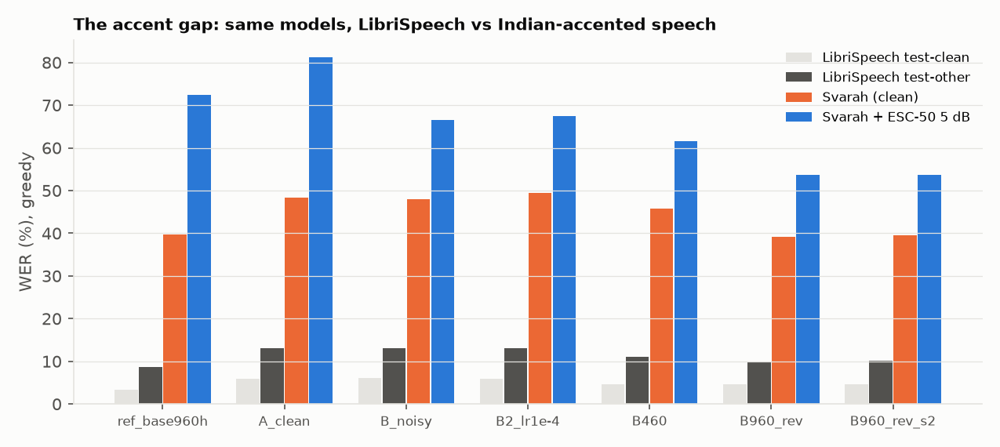

*Figure 15. The same models on LibriSpeech and on Indian-accented speech (Svarah).*

### 8.2 Do the project's improvements carry over?

Paired bootstrap 95 % CIs, resampled by utterance (1,000 resamples), on Svarah:

| Change | Svarah clean | Svarah ESC-50 0–5 dB | LibriSpeech ESC-50 0–5 dB |
| :---- | ----: | ----: | ----: |
| Noise training, A → B (greedy) | −0.8 % (−1.3 to −0.2) | **−17.2 %** (−17.8 to −16.7) | −47.4 % |
| More data, B → B460 (LM) | −3.4 % (−4.1 to −2.5) | −6.5 % (−7.0 to −6.1) | −16.1 % |
| More data + reverb/speed/telephone augmentation, B460 → B960_rev (LM) | **−13.9 %** (−14.7 to −13.2) | −11.5 % (−12.0 to −11.0) | −7.2 % |
| 4-gram LM, B960_rev greedy → LM | −17.7 % (−18.4 to −17.0) | −14.0 % (−14.4 to −13.6) | −23.7 % |
| ROVER, B960_rev (LM) → ROVER | −1.6 % (−2.1 to −1.0) | −1.9 % (−2.2 to −1.6) | −2.8 % |

* **Every improvement still helps, and every CI excludes zero.**
* **Noise training still meets the O2 target** in noise: −17 %, against a target of at least 15 %.
* **The broader B960_rev augmentation helps accented speech most** (−14 % on clean speech, against 5 % on LibriSpeech).

### 8.3 Error flags and replay on accented speech

| Metric | LibriSpeech | Svarah (all conditions) | Svarah clean |
| :---- | ----: | ----: | ----: |
| Share of words wrong | 7.6 % | 37.5 % | 26.0 % |
| Detector AUROC (raw confidence) | 0.892 (0.865) | **0.870** (0.843) | 0.861 (0.824) |
| Errors caught in the riskiest 30 % of words | 86.5 % | 62.4 % | **70.8 %** |
| ECE | 0.006 | 0.069 | 0.060 |
| Precision of flags at threshold 0.5 | 69.3 % | 81.4 % | 79.8 % |
| Flags with the error inside the ±1 s replay window | 99.0 % | **94.2 %** (of 87,566) | — |

* **The ranking transfers.** The detector still ranks wrong words first and beats raw confidence everywhere.
* **Calibration and replay stay within target.** ECE (0.069) is within the O3 limit of 0.10, and the replay window still meets O4 (at least 90 %).
* **Recall in the riskiest 30 % falls below 70 % only because there are so many errors.** With 37.5 % of words wrong, reviewing 30 % of the words can catch at most 80 % of the errors. On clean accented speech the target is met.
* **Calibration error rises because the detector under-estimates risk.** On accented speech, words that look confident are wrong more often than their score suggests.

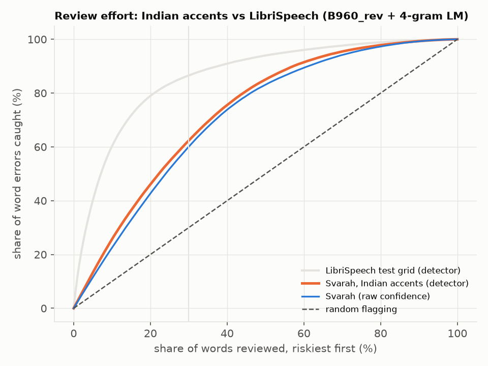

*Figure 16. Errors caught against words reviewed: Svarah vs LibriSpeech.*

### 8.4 Where the errors come from

* **Unknown names and acronyms:** Indian names, places and acronyms such as KARNATAKA, AICTE and OTP are missing from the LM vocabulary. They are 4.45 % of words, and 98.7 % of them are wrong.
* **Accent-specific sounds:** vowel confusions, and T heard as D (retroflex consonants).
* **Very short clips:** clips under 2 s have 51.2 % WER, against 29–32 % for longer clips.
* **Native language:** WER on clean speech ranges from Tamil (24.4 %) and Hindi (25.3 %) to Assamese (42.0 %). Each language has only a few speakers, so this ranking is indicative.

### 8.5 Comparison with published results and conclusion

The Svarah paper [R10] reports these WERs without an LM:

| Model | Size | Svarah WER |
| :---- | ----: | ----: |
| wav2vec 2.0 large | 317 M | 24.9 % |
| Conformer large | 120 M | 14.6 % |
| Whisper large | 1,550 M | 7.2 % |
| **Our B960_rev, greedy** | 95 M | **39.2 %** |

* **The comparison is indicative only.** The paper's text normalisation is not described.
* **The pattern is the same as for other models trained on LibriSpeech-style data.** They lose a factor of about 10 on Indian accents, while Whisper, trained on 680,000 h of varied data, loses much less.
* **On clean accented speech our model equals the published base-960h model** (−1.1 %, CI −1.9 to −0.3). In noise it is **24.5 % better** (CI −25.1 to −23.9).

**Conclusion.** The project's gain is noise robustness, as designed, not accent robustness. The flagging and replay workflow remains useful exactly where the transcript is weakest. Accent adaptation (fine-tuning on Indian English, an Indian-English LM) is outside the project's scope; this section measures the gap instead of assuming it.

---

## 9. Evaluation Artifacts

| Artifact | Location |
| :---- | :---- |
| This report | `milestones/M5_evaluation/Milestone5_Group9_Evaluation_Report.{md,pdf}` |
| Result tables (CSV/JSON) | `milestones/M5_evaluation/tables/` (model comparison, S/D/I, ESC-50 per class and group, word frequency and length, duration, speakers, character confusion, detector confusion, LM fixed vs broken, qualitative examples, assistant benchmark) |
| Figures 1–8 | `milestones/M5_evaluation/figures/m5_fig1–7*.png`, `experiments/results/B960_rev_lm4/error_detector/reliability.png` |
| Replay check (O4) | `milestones/M5_evaluation/replay_check/` (`summary.json`, `per_condition.csv`, `sample_flags.csv`, `clips/`; listening check: `listening_check.html` and the answers `sample_flags_PD.csv`) |
| Per-utterance test outputs | `experiments/results/<model>{,_ext,_lm4}/`, `experiments/results/rover3_final/` |
| Error detector | `experiments/results/B960_rev_lm4/error_detector/` (`model.joblib`, `metrics.json`, `per_condition.csv`) |
| **Complete evaluation (one entry point)** | `notebooks/M5_evaluation.ipynb` (all charts, tables and audio examples inline) and `scripts/m5_evaluate.py` (same functions, no notebook) |
| Shared evaluation code | `src/group9_ds_ai_lab/evaluation/m5.py` (one function per analysis), `src/group9_ds_ai_lab/evaluation/models.py` (model registry: server path and Hugging Face id) |
| New tables and figures | `tables/g1_*` (WER/CER grid), `g2_*` (breakdown SNR), `g3_*` (accuracy up/down), `g4_*` (bootstrap CIs), `g5_*` (review effort, F1), `g6_*` (flags by error category), `g7_*` (CPU/GPU speed), `g8_*` (audio examples, `audio_examples/`), `g11_*` (objectives), `g12_*` (Hugging Face reproducibility); `figures/g*.png` |
| Analysis and benchmark scripts | `scripts/m5_analysis.py`, `scripts/replay_window.py`, `scripts/benchmark_assistant.py`, `scripts/transcribe.py` |
| Assistant (app) | `src/group9_ds_ai_lab/assistant/`, `deployment/app/` |
| Models | Hugging Face: `kumargulshan/wav2vec2-base-ls100-clean` (A), `-ls100-noise-aug` (B), `-ls100-noise-aug-lr1e-4` (B2), `-ls460-noise-aug` (B460), `-ls960-noise-robust` (B960_rev, used by the assistant), `-ls960-noise-robust-seed7` (B960_rev_s2) |
| Indian-accent evaluation (§8) | `scripts/svarah_evaluate.py`; `milestones/M5_evaluation/indian_accent/` (separate report `.md`/`.pdf`, `tables/`, `figures/`, `audio_examples/`); dataset `data/raw/svarah/` (not in git) |
| Noise examples | `docs/augmentation_demo/` (clean, each noise source, training and held-out noise at several SNRs, full augmentation chain), also played in the notebook |

## References

* [R1] Q.-S. Zhu, J. Zhang, Z.-Q. Zhang, M.-H. Wu, X. Fang, L.-R. Dai, "A noise-robust self-supervised pre-training model based speech representation learning for automatic speech recognition," *Proc. IEEE ICASSP*, 2022, pp. 3174–3178. arXiv:2201.08930.
* [R2] A. Baevski, Y. Zhou, A. Mohamed, M. Auli, "wav2vec 2.0: A framework for self-supervised learning of speech representations," *Advances in Neural Information Processing Systems (NeurIPS)*, 2020. arXiv:2006.11477.
* [R3] D. Oneață, A. Caranica, A. Stan, H. Cucu, "An evaluation of word-level confidence estimation for end-to-end automatic speech recognition," *Proc. IEEE Spoken Language Technology Workshop (SLT)*, 2021. arXiv:2101.05525.
* [R4] C. Guo, G. Pleiss, Y. Sun, K. Q. Weinberger, "On calibration of modern neural networks," *Proc. ICML*, 2017. arXiv:1706.04599.
* [R5] V. Panayotov, G. Chen, D. Povey, S. Khudanpur, "LibriSpeech: an ASR corpus based on public domain audio books," *Proc. IEEE ICASSP*, 2015.
* [R6] K. J. Piczak, "ESC: Dataset for environmental sound classification," *Proc. ACM Multimedia*, 2015.
* [R7] D. Snyder, G. Chen, D. Povey, "MUSAN: A music, speech, and noise corpus," arXiv:1510.08484, 2015.
* [R8] J. G. Fiscus, "A post-processing system to yield reduced word error rates: Recognizer output voting error reduction (ROVER)," *Proc. IEEE ASRU*, 1997.
* [R9] A. Prasad, P. Jyothi, R. Velmurugan, "An investigation of end-to-end models for robust speech recognition," *Proc. IEEE ICASSP*, 2021 (the noisy test set and baselines used by [R1]).
* [R10] T. Javed, S. Joshi, V. Nagarajan, S. Sundaresan, J. Nawale, A. Raman, K. Bhogale, P. Kumar, M. M. Khapra, "Svarah: Evaluating English ASR systems on Indian accents," *Proc. Interspeech*, 2023. arXiv:2305.15760. Dataset: huggingface.co/datasets/ai4bharat/Svarah (CC BY 4.0).

---

## Contribution and Acknowledgement

The contributions for this milestone are also recorded in `WORKLOG.md`.

| Name | Roll No. | Contribution to Milestone 5 | Initials |
| :---- | :---- | :---- | :---- |
| Gulshan Kumar | 22f1000072 | **Evaluation code:** the shared code (`src/group9_ds_ai_lab/evaluation/`), the script `scripts/m5_evaluate.py` and the notebook `notebooks/M5_evaluation.ipynb`. **Runs on the test grid:** WER/CER, bootstrap CIs, breakdown SNR, review effort, CPU/GPU speed, and the Hugging Face reproducibility check. **Indian-accent evaluation (Svarah):** the separate script and report. **This report:** writing it, with the figures and the literature comparison. | G.K. |
| Parashmani Datta | 21f2000987 | Review of the report, its results and conclusions. **Code review** of the evaluation code (`src/group9_ds_ai_lab/evaluation/`, `scripts/m5_evaluate.py`, `scripts/svarah_evaluate.py`). **O4 listening check:** listened to the 50 sampled replay clips and recorded whether each target word was heard (46/50; `replay_check/sample_flags_PD.csv`). | P.D. |
| Subhojit Saha | 21f1003945 | Review of the report, its results and conclusions. **Code review** of the evaluation code (`src/group9_ds_ai_lab/evaluation/`, `scripts/m5_evaluate.py`, `scripts/svarah_evaluate.py`). | S.S. |

All members have read this report and agree to its submission for Milestone 5.
