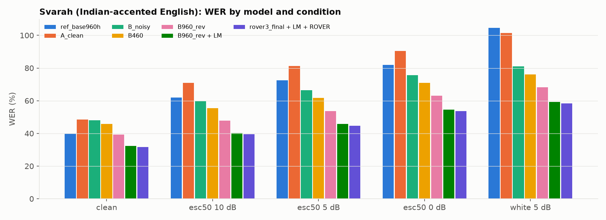
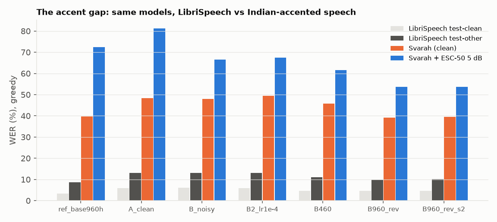
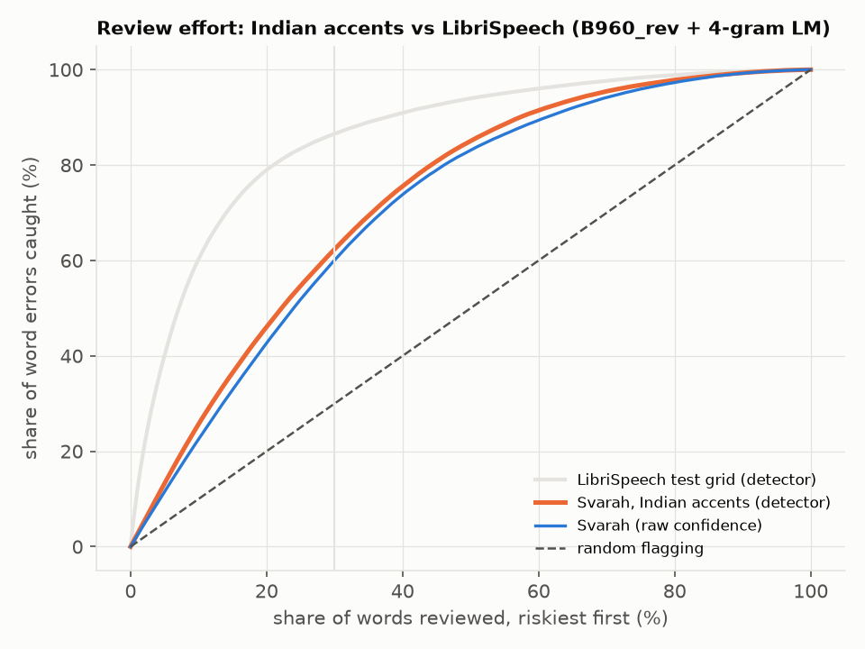
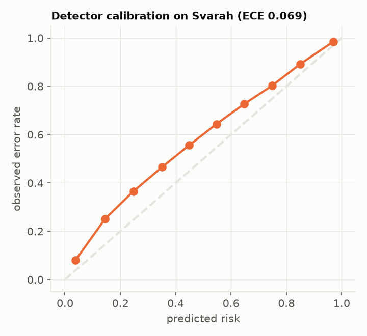
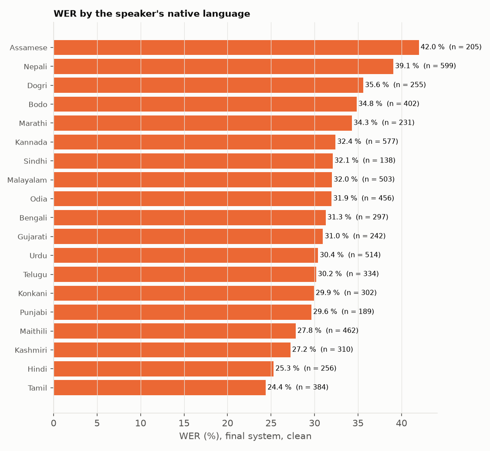

**Noise-Robust Speech Recognition with Word-Level Error Flagging: Evaluation on Indian-Accented English**

**GROUP 9**

Milestone 5, supplementary evaluation report

Course: DS-AI Lab · Term: October 2026 · Submission: 26 November 2026

---

## Summary

The main Milestone 5 report evaluates our models on LibriSpeech, which is read audiobook speech, mostly by North American speakers. The assistant's intended users record interviews in India. This supplementary report measures how the **same models, unchanged**, perform on Indian-accented English.

* **Dataset:** the public **Svarah** benchmark [S1]: 9.6 h, 6,656 utterances, 117 speakers, 19 native languages, 65 districts.
* **Nothing is retrained.** The evaluation is a separate script (`scripts/svarah_evaluate.py`). It imports the project's own inference, noise mixing, LM decoding, ROVER and detector code, so the numbers are directly comparable with the main report.

| Headline result | LibriSpeech (main report) | **Svarah (Indian accents)** |
| :---- | ----: | ----: |
| Final system WER, clean speech | 2.89 % (test-clean) / 6.92 % (test-other) | **31.74 %** |
| Final system WER, ESC-50 noise at 5 dB | 8.70 % | **44.76 %** |
| Final system WER, ESC-50 noise at 0 dB | 14.14 % | **53.56 %** |
| Noise training A → B, ESC-50 0–5 dB, greedy (relative change, 95 % CI) | −47.4 % (−48.2 to −46.7) | **−17.2 %** (−17.8 to −16.7) |
| Error detector AUROC / errors in riskiest 30 % / ECE | 0.892 / 86.5 % / 0.006 | **0.870 / 62.4 % / 0.069** |
| Flags with the error inside the ±1 s replay window | 99.0 % | **94.2 %** |

**Main findings:**

1. **Indian accents are much harder than LibriSpeech for every model.** WER is about 11 times higher on clean speech: 31.7 % vs 2.9 %. A published, larger wav2vec 2.0 model shows the same kind of gap on Svarah: 24.9 % vs 1.8 % [S1].
2. **The project's improvements still help.**
   - Noise training, more data with augmentation, the LM and ROVER each reduce WER on Indian speech as well, and every CI excludes zero.
   - Accents and noise add up: at 0 dB, half the words are wrong.
3. **The error detector transfers well.** It still ranks wrong words first (AUROC 0.87), its flags are right 81 % of the time, and replay still finds the error 94 % of the time. Its calibration error grows from 0.006 to 0.069, which is still inside the O3 limit of 0.10. Because 37.5 % of words are wrong, reviewing 30 % of the words can catch at most 80 % of the errors; the detector catches 62 %.
4. **Most of the remaining errors have clear causes:**
   - Indian names, places and acronyms the LM does not know (KARNATAKA, AICTE, EPFO, OTP); 98.7 % of them are wrong.
   - Vowel confusions, and T → D (retroflex consonants).
   - Very short clips.
   - Numbers spoken digit by digit (PIN codes, OTPs).

This confirms the limitation stated in the main report: accented speech is out of the training domain. It is now measured instead of assumed.

---

## 1. Evaluation setup

### 1.1 Models and pipeline (unchanged from the main report)

The models are exactly the systems of the main report, loaded from the same checkpoints (identical to the public Hugging Face copies, main report §3.8):
* the reference `facebook/wav2vec2-base-960h`;
* Model A (clean, 100 h), Model B (noise, 100 h), B2 (lr 1e-4), B460, B960_rev and B960_rev_s2.

They are decoded with:
* **greedy** decoding;
* the **4-gram LibriSpeech LM**, with the same α 0.8, β 2.0 and beam 50;
* the final **ROVER** of B960_rev_s2 + B960_rev + B460 (λ 0.5).

The **word-error detector** is the one trained on LibriSpeech dev words; it is applied as is.

### 1.2 Evaluation dataset

| Item | Value |
| :---- | :---- |
| Source | **Svarah** (AI4Bharat, Interspeech 2023) [S1], `huggingface.co/datasets/ai4bharat/Svarah`, licence CC BY 4.0 |
| Size | 6,656 utterances, 9.61 h, about 73,000 reference words (after normalisation) |
| Speakers | 117 speakers; 19 native languages; 17 states; both genders; age groups 18–30 to 60+ |
| Content | read and spontaneous speech: history, culture, tourism, and everyday tasks (payments, government services, groceries) |
| Role | **test only**: no setting in this report was tuned on Svarah |

### 1.3 Preprocessing during evaluation

* **Audio:** every clip is 16 kHz already; it is stored as 16-bit PCM and z-normalised before the model, as in training.
* **Transcripts:** the same `normalize_text()` as for training: upper case, letters, apostrophe and space.
* **Numbers.** Svarah writes some numbers as digits; 769 utterances (12 %) contain at least one. They are converted to words before scoring:
  - cardinals: 10,000 → TEN THOUSAND;
  - years: 1998 → NINETEEN NINETY EIGHT;
  - ordinals: 21st → TWENTY FIRST;
  - ranges: 15–17 → FIFTEEN TO SEVENTEEN;
  - symbols: % → PERCENT, & → AND, + → PLUS.

  Spoken numbers have several valid readings, so every WER is also reported **on the 5,887 utterances without digits** (`wer_no_digit_utts_%`).
* **Noise:** the same conditions as the main grid, mixed with the project's seeded `apply_condition()`. Every model hears identical audio:
  - clean (as recorded);
  - ESC-50 at 10 / 5 / 0 dB (held-out real-world sounds);
  - white noise at 5 dB.

  That is 5 conditions × 6,656 = **33,280 utterance-conditions per system**.

### 1.4 Evaluation environment

| Item | Setting |
| :---- | :---- |
| Hardware | 1 × NVIDIA L40S (inference, bf16, about 70 s per model and condition); CPU pool of 96 processes for the LM beam search |
| Software | Python 3.14, PyTorch 2.14.1, transformers 5.23.0, pyctcdecode 0.5.0 + kenlm 0.3.0, jiwer 4.0.0, scikit-learn 1.9.1 |
| Runtime | complete run: about 50 min (prepare 6 s, GPU inference 42 min, 4-gram LM 4 min, analysis 4 min) |
| Command | `python scripts/svarah_evaluate.py` (stages `prepare infer lm rover analyse`) |
| Randomness | fixed seeds for noise mixing, the bootstrap (1,000 resamples) and the example selection |

---

## 2. Metrics

The metrics and definitions are the same as in the main report, Section 2:
* WER and CER, pooled over all words, with the S / D / I split;
* relative change with **paired bootstrap 95 % CIs**, resampling utterances (all conditions of a clip together);
* for the detector: AUROC, recall in the riskiest 30 %, ECE, and precision / recall at the app's threshold of 0.5;
* the replay-window hit rate.

---

## 3. Quantitative results

### 3.1 All models, all conditions (WER %, all utterances)

| System | Decoding | Clean | ESC-50 10 dB | ESC-50 5 dB | ESC-50 0 dB | White 5 dB |
| :---- | :---- | ----: | ----: | ----: | ----: | ----: |
| Reference base-960h | greedy | 39.63 | 61.89 | 72.44 | 81.99 | 104.56 |
| Model A (clean, 100 h) | greedy | 48.42 | 71.03 | 81.24 | 90.39 | 101.33 |
| Model B (noise, 100 h) | greedy | 48.05 | 59.59 | 66.49 | 75.55 | 81.05 |
| B2 (lr 1e-4) | greedy | 49.49 | 60.99 | 67.50 | 76.01 | 81.86 |
| B460 | greedy | 45.78 | 55.44 | 61.64 | 70.82 | 76.00 |
| B960_rev | greedy | 39.20 | 47.86 | 53.68 | 62.96 | 68.14 |
| Model A | 4-gram LM | 39.27 | 60.62 | 69.87 | 78.44 | 90.93 |
| Model B | 4-gram LM | 38.75 | 49.75 | 56.16 | 65.07 | 70.26 |
| B460 | 4-gram LM | 37.45 | 46.56 | 52.23 | 61.07 | 65.52 |
| B960_rev | 4-gram LM | 32.25 | 40.28 | 45.72 | 54.55 | 59.27 |
| **ROVER (final)** | LM + ROVER | **31.74** | **39.53** | **44.76** | **53.56** | **58.30** |

Source: `tables/svarah_wer_cer_grid.csv`, which also has CER, S/D/I and B960_rev_s2. **WER above 100 %** (reference model, white noise) means the model inserted more words than the reference contains. In noise it outputs many short fragments.

**Without the 769 utterances that contain digits,** the final system's WER is 29.59 % clean and 43.58 % at ESC-50 5 dB, about 1–2 points lower everywhere. The ranking of the systems does not change.

*Figure 1. WER on Svarah by model and condition.*

### 3.2 The accent gap: the same models on LibriSpeech and on Svarah

| System (greedy) | LibriSpeech test-clean | LibriSpeech test-other | **Svarah clean** | LibriSpeech ESC-50 5 dB | **Svarah ESC-50 5 dB** |
| :---- | ----: | ----: | ----: | ----: | ----: |
| Reference base-960h | 3.43 | 8.59 | 39.63 | 26.44 | 72.44 |
| Model A | 5.85 | 13.03 | 48.42 | 29.97 | 81.24 |
| Model B | 6.19 | 13.08 | 48.05 | 16.26 | 66.49 |
| B460 | 4.70 | 11.09 | 45.78 | 13.27 | 61.64 |
| B960_rev | 4.63 | 9.95 | 39.20 | 12.21 | 53.68 |
| ROVER (final, LM) | 2.89 | 6.92 | 31.74 | 8.70 | 44.76 |

*Figure 2. The same models on LibriSpeech and on Indian-accented speech. Source: `tables/svarah_vs_librispeech.csv`.*

### 3.3 Do the project's improvements carry over? (paired bootstrap 95 % CIs)

Source: `tables/svarah_bootstrap_ci.csv`. The relative change is WER(after) / WER(before) − 1; negative values are improvements.

| Change | Svarah clean | Svarah ESC-50 0–5 dB | LibriSpeech ESC-50 0–5 dB (main report) |
| :---- | ----: | ----: | ----: |
| Noise training, A → B (greedy) | −0.8 % (−1.3 to −0.2) | **−17.2 %** (−17.8 to −16.7) | −47.4 % |
| More data, B → B460 (LM) | −3.4 % (−4.1 to −2.5) | −6.5 % (−7.0 to −6.1) | −16.1 % |
| More data + reverb/speed/telephone augmentation, B460 → B960_rev (LM) | **−13.9 %** (−14.7 to −13.2) | −11.5 % (−12.0 to −11.0) | −7.2 % |
| 4-gram LM, B960_rev greedy → LM | −17.7 % (−18.4 to −17.0) | −14.0 % (−14.4 to −13.6) | −23.7 % |
| ROVER, B960_rev (LM) → ROVER | −1.6 % (−2.1 to −1.0) | −1.9 % (−2.2 to −1.6) | −2.8 % |
| Ours vs published model: base-960h → B960_rev (greedy) | −1.1 % (−1.9 to −0.3) | **−24.5 %** (−25.1 to −23.9) | — |

**Noise training still helps strongly in noise** (−17 %, still above the 15 % target of O2), and it does not hurt clean accented speech.

**The B960_rev recipe helps accented speech more than LibriSpeech.** From B460 to B960_rev, clean Svarah improves by 14 %, against 5 % on clean LibriSpeech. Speed perturbation, reverberation, telephone band-limiting and the 500 h of harder "other" speech make the model less sensitive to how a speaker sounds.

**On clean accented speech our model is no better than the published model** (−1 %), but in noise it is 24 % better. The project's gain is noise robustness, not accent robustness, which is what it was designed for.

### 3.4 Comparison with published results on Svarah

The Svarah paper [S1] reports WER without a language model:

| Published model | Size | Svarah WER | LibriSpeech test-clean WER |
| :---- | ----: | ----: | ----: |
| Whisper large | 1,550 M | 7.2 % | 2.7 % |
| Conformer large (NVIDIA) | 120 M | 14.6 % | 2.1 % |
| wav2vec 2.0 large | 317 M | 24.9 % | 1.8 % |
| Azure / Google (en-IN) | — | 21.3 % / 20.7 % | — |
| **Ours: B960_rev, greedy (base size, no LM)** | 95 M | **39.2 %** (37.3 % without digit utterances) | 4.6 % |

* **The comparison is indicative only.** The paper does not describe its text normalisation, so the absolute numbers are not strictly comparable.
* **The pattern is clear.** Models trained mostly on LibriSpeech-style data lose a factor of 10–14 on Indian accents. Our base-size model, 3 times smaller than wav2vec 2.0 large, behaves the same way. Models trained on far more varied data (Whisper, 680,000 h) lose much less.
* Bigger models and more varied training data are outside the scope of this project (Milestone 1 §1.3).

---

## 4. Visualisations

### 4.1 Error detector on Indian-accented speech

| Subset | Error rate | AUROC (detector / raw confidence) | Errors in riskiest 30 % | ECE | Precision at 0.5 | Recall at 0.5 |
| :---- | ----: | ----: | ----: | ----: | ----: | ----: |
| All 5 conditions (340,511 words) | 37.5 % | **0.870** / 0.843 | 62.4 % | 0.069 | 81.4 % | 55.8 % |
| Clean | 26.0 % | 0.861 / 0.824 | 70.8 % | 0.060 | 79.8 % | 40.7 % |
| ESC-50 5 dB | 37.0 % | 0.866 / 0.839 | 62.2 % | 0.067 | 80.8 % | 55.1 % |
| ESC-50 0 dB | 43.9 % | 0.871 / 0.846 | 57.8 % | 0.074 | 82.4 % | 62.0 % |
| LibriSpeech (main report) | 7.6 % | 0.892 / 0.865 | 86.5 % | 0.006 | 69.3 % | 30.7 % |

*Figure 3. Share of errors caught against share of words reviewed. Svarah (orange) vs LibriSpeech (grey).*

**The ranking transfers.** AUROC drops only from 0.892 to 0.870, and the trained detector still beats raw confidence in every condition.

**Recall in the riskiest 30 % falls (62 % vs 86.5 %) because there are far more errors.** When 37.5 % of words are wrong, reviewing 30 % of the words can catch at most 80 % of the errors. On clean Svarah, where 26 % of words are wrong, it still meets the 70 % target (70.8 %).

**More flags, and more of them correct.** At threshold 0.5 the app flags many more words than on LibriSpeech, and 81 % of them really are wrong.

*Figure 4. Detector calibration on Svarah.* The detector **under-estimates** risk on accented speech: words it scores at 30 % are wrong more often than 30 % of the time. ECE grows from 0.006 to 0.069, which is still within the O3 limit of 0.10. Words that look confident to an acoustic model trained on LibriSpeech are more often wrong for an Indian speaker.

### 4.2 Replay window (O4)

The reference word times come from CTC forced alignment of the transcript on the clean B960_rev output, the same method as the main report.

**94.2 % of the 87,566 flags** (B960_rev + LM, all conditions) have the wrong word inside the ±1 s replay window. On LibriSpeech the figure is 99.0 %. The O4 target (≥ 90 %) is met.

The rate is lower because accented clips are short and contain more errors next to each other, so forced alignment and hypothesis alignment are less exact.

---

## 5. Qualitative results

The examples are selected automatically from the clean condition (seed 0): four utterances that are correct, and the four with the highest error rate. The audio is in `audio_examples/`; source: `tables/svarah_examples.csv`.

**Successful predictions** (final system, word for word correct):

| Speaker's native language | Reference = output |
| :---- | :---- |
| Tamil | IT WAS ESTABLISHED AS A HOLIDAY IN NINETEEN SIXTY FOUR |
| Kannada | CAN YOU SPEAK FIVE NUMBERS BETWEEN TEN AND TEN THOUSAND |
| Marathi | WHICH IS SUPPLIED TO SUGAR MILLS |
| Urdu | PLEASE SET MY ALARM FOR FIVE P M |

**Failure cases:**

| Native language | Reference | Final system | Why |
| :---- | :---- | :---- | :---- |
| Telugu | WEST GODAVARI NTR KRISHNA PALLANADU GUNTUR | WHERE TO GO DAVEY IN PRE CHRISHNA PALNARDO GUNTO | Indian place names are not in the LM; the model writes them phonetically or as English look-alikes |
| Malayalam | THE ARTISTIC FIELD OF KERALA COMPRISES ANCIENT CLASSICAL ART | IN THE ARTISTIC FIELD OF CALECOMPRISE'S ANCIENT CLASSICAL ART FORGOT AS WELL AS … | KERALA is unknown to the LM; the recording also continues after the end of the transcript, so the extra words count as insertions |
| Bodo | NOW WITH THE ADVENT OF SOCIAL MEDIA WE CAN ACCESS THE GALLERIES OF THE MUSEUM | EDIE AND ACKNOWLEGY HAS MADE POSSIBLE … ACCESTORHEMIGALERY OF THE MUSEUM | a strongly accented speaker; the transcript covers only part of the speech |

Some of the worst cases are partly **dataset artefacts**: the transcript covers only part of the audio. These inflate insertions; Svarah's transcripts are not perfectly aligned with the clips.

---

## 6. Error analysis

### 6.1 Error types (final system)

| Condition | Substitutions | Deletions | Insertions | WER |
| :---- | ----: | ----: | ----: | ----: |
| Clean | 20.1 % | 7.7 % | 3.9 % | 31.7 % |
| ESC-50 5 dB | 28.3 % | 12.5 % | 4.0 % | 44.8 % |
| ESC-50 0 dB | 32.3 % | 17.8 % | 3.4 % | 53.6 % |

As on LibriSpeech, substitutions dominate and deletions grow fastest with noise. On clean Svarah, deletions alone (7.7 %) exceed the whole LibriSpeech test-clean WER.

### 6.2 Which words go wrong

* **Out-of-vocabulary words.**
  - 4.5 % of reference words are not in the LibriSpeech LM, against 0.5 % on LibriSpeech, and **98.7 % of them are recognised wrongly**.
  - The most frequent are Indian places and institutions, plus modern technical words: KARNATAKA, ESIC, KERALA, PINCODE, OTP, AICTE, PRADESH, EPFO, MAHARASHTRA, GRAMIN, LOGIN, YOUTUBE.
  - In-vocabulary words are wrong 24.5 % of the time.
* **Numbers.**
  - **Number words fill most of the top 20 substitutions** (HUNDRED → NINE, TWENTY → THOUSAND, …). Speakers read PIN codes, OTPs and amounts digit by digit, while a written "560001" is converted to FIVE HUNDRED SIXTY THOUSAND ONE.
  - This is a scoring artefact, not an accent effect; it is why the no-digit WER is 1–2 points lower (§3.1).
* **Function words.** A ↔ THE, THEY → THE and THEIR → THE are frequent, as on LibriSpeech.

### 6.3 Character confusions (inside substituted words)

The top confusions are vowels: A → E (792), I → E (503), A → O (412), E → I (405), E → A (388). Next comes **T → D (328)**, the retroflex consonants of many Indian languages, which a LibriSpeech-trained model hears as D. Vowel quality is the main difference between Indian and North American English. (`tables/svarah_top_char_confusions.csv`)

### 6.4 Where the model does well or poorly

**By the speaker's native language** (final system, clean, groups with ≥ 40 utterances):

*Figure 5. WER by the speaker's native language.*

| Best | WER | Worst | WER |
| :---- | ----: | :---- | ----: |
| Tamil | 24.4 % | Assamese | 42.0 % |
| Hindi | 25.3 % | Nepali | 39.1 % |
| Kashmiri | 27.2 % | Dogri | 35.6 % |
| Maithili | 27.8 % | Bodo | 34.8 % |

**Other groups:**
* **Gender:** female speakers 30.3 %, male 33.6 %.
* **Age:** 30–45 years 29.9 %; 60+ years 36.0 %.
* **Education:** doctoral level 27.0 %; school level 35.2 %.
* **State:** from 23.6 % (Telangana) to 37.6 % (West Bengal).

These groups differ in size, and the dataset does not identify individual speakers. With 117 speakers across 19 languages, each language rests on only a few speakers, so the language ranking should be read as indicative. (`tables/svarah_wer_by_speaker_group.csv`)

**By utterance length:** clips shorter than 2 s have **51.2 %** WER, against 29–32 % for every length above 2 s. A quarter of Svarah's clips are short commands or one-word answers, where the LM has no context and a single error weighs heavily.

---

## 7. Observations and limitations

### 7.1 Key observations

1. **The accent gap is larger than the noise gap.** Clean Indian-accented speech (31.7 % WER) is harder for our final system than LibriSpeech at 0 dB in ESC-50 noise (14.1 %).
2. **Each project improvement still reduces errors, but by less.** The training noise makes the model robust to *sounds around* the speaker, not to *how the speaker pronounces*. The broader B960_rev augmentation is the one change that helps accents noticeably (−14 % on clean speech).
3. **The flagging and replay workflow stays useful.**
   - The detector ranks errors almost as well as on LibriSpeech.
   - Replay finds the error 94 % of the time.
   - Most flags are real errors.

   That matters most exactly where the transcript is weakest.
4. **Names are the main weak point.** Indian names and places are nearly always wrong. This supports the glossary idea, the project's separate novelty, which is evaluated elsewhere.

### 7.2 Anomalies and explanations

| Observation | Explanation |
| :---- | :---- |
| WER above 100 % (reference model, white noise) | the model inserts many short fragments in noise; WER counts insertions without limit |
| Recall in the riskiest 30 % below the 70 % target | 37.5 % of words are wrong, so the maximum possible is 80 %; on clean Svarah the target is met (70.8 %) |
| ROVER helps slightly less than on LibriSpeech in noise (−1.9 vs −2.8 %) | all three members share the same blind spots (accent, vocabulary), so voting finds fewer independent errors to correct |
| Very poor results on some utterances | partly dataset artefacts: transcripts covering only part of the audio |

### 7.3 Limitations

* **Scope.** Indian-accent adaptation (fine-tuning on Indian English, an Indian-English LM) is outside the project's scope. This report only measures the gap.
* **Number normalisation is ambiguous.** WER is therefore reported with and without utterances containing digits.
* **Speaker groups are small** (a few speakers per language), so differences between languages are indicative only.
* **The published comparison is indicative.** The Svarah paper does not describe its normalisation and uses no LM.
* **The detector and LM were built on LibriSpeech.** Recalibrating the detector on accented speech would reduce its calibration error, but that would mean training on accented data, which is not done here.

---

## 8. Artifacts

| Artifact | Location |
| :---- | :---- |
| This report | `milestones/M5_evaluation/indian_accent/Milestone5_Group9_Indian_Accent_Evaluation.{md,pdf}` |
| Evaluation script (separate from the main evaluation) | `scripts/svarah_evaluate.py` |
| Tables | `milestones/M5_evaluation/indian_accent/tables/` (WER/CER grid and pivots, LibriSpeech comparison, bootstrap CIs, detector, review curve, speaker groups, duration, substitutions, character confusions, examples, summary) |
| Figures and audio examples | `milestones/M5_evaluation/indian_accent/figures/`, `audio_examples/` |
| Per-utterance outputs | `experiments/results/svarah/` (LM and ROVER predictions, word confidences; not in git) |
| Prepared audio and log-probabilities | `data/processed/svarah/` (not in git; recreated by the script) |
| Dataset | `data/raw/svarah/` (downloaded from Hugging Face after accepting the dataset's terms; not in git) |
| Log | `experiments/logs/svarah_evaluate.log` |

## References

* [S1] T. Javed, S. Joshi, V. Nagarajan, S. Sundaresan, J. Nawale, A. Raman, K. Bhogale, P. Kumar, M. M. Khapra, "Svarah: Evaluating English ASR systems on Indian accents," *Proc. Interspeech*, 2023. arXiv:2305.15760. Dataset: huggingface.co/datasets/ai4bharat/Svarah (CC BY 4.0).
* [S2] A. Baevski, Y. Zhou, A. Mohamed, M. Auli, "wav2vec 2.0: A framework for self-supervised learning of speech representations," *NeurIPS*, 2020.
* [S3] K. J. Piczak, "ESC: Dataset for environmental sound classification," *Proc. ACM Multimedia*, 2015.
* [S4] J. G. Fiscus, "A post-processing system to yield reduced word error rates: ROVER," *Proc. IEEE ASRU*, 1997.
* The main Milestone 5 report: `milestones/M5_evaluation/Milestone5_Group9_Evaluation_Report.pdf`.
